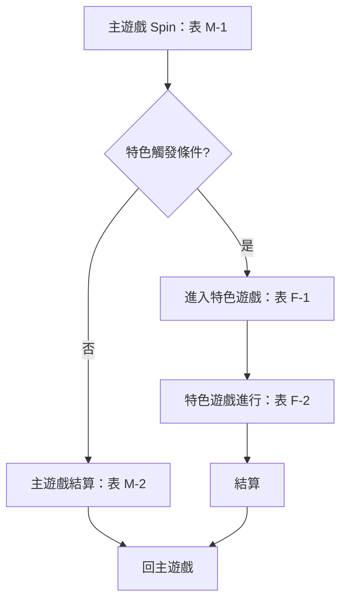

# <遊戲名> 機率規格書（Content 軌）

> md 模式範本（ark-game-prob 1.4）：沒有 xlsx、沒有快測也能寫；**表頭照本範本命名**，`ps_html` 就會把每張表畫成 KPI / 熱度表 / 長條 / 旗標 / 帶面。
> 六段標題（`## 1.`～`## 6.`）不可改名、不可調序（ps_lint PS-SECTIONS）；最後一欄「來源」寫出處（決議 D-id / 規格書章節 / 設定檔鍵 / xlsx 座標），沒定案的值寫「待決議」且不帶來源。
> 寫完：`python scripts/ps_run.py --md <本檔> --dest <目錄>` → prob-spec.html + lint-report.json。本段引言可刪。

## 1. 規格簡述

### 基本規格

| 項目 | 值 | 來源 |
|---|---|---|
| 盤面 | 3x5 | 規格書 §1 |
| 對獎方式 | All Ways | 規格書 §1 |
| 基本收費 | 132 | 規格書 §1 |

### Pay table（odds × Line bet）

| 層級 | 符號 | x3 | x4 | x5 | 來源 |
|---|---|---|---|---|---|
| High Pay Symbols | M1 | 20 | 60 | 250 | 規格書 §2 |
| Low Pay Symbols | FA | 5 | 8 | 10 | 規格書 §2 |

### 機率人員簡述

<!-- human:summary -->
（2–4 句：主遊戲怎麼得分、特色怎麼觸發、特色遊戲型態；數字請標來源）
<!-- /human -->

## 2. 數據資料

### 快測摘要

> 總覽 KPI、RTP 組成圖、驗收守門都由本表產生；未快測整表留「—」。「golden RTP」= 參數表加權理論值；設計局用「目標 RTP」。

| 指標 | 值 | 來源 |
|---|---|---|
| 總 RTP | — | rtp-report.json |
| 主遊戲 RTP | — | rtp-report.json |
| 免費遊戲 RTP | — | rtp-report.json |
| 主遊戲命中率 | — | rtp-report.json |
| 主遊戲最大倍數 | — | rtp-report.json |
| FG 觸發率 | — | rtp-report.json |
| FG 平均觸發局數 | — | rtp-report.json |
| FG 平均倍率 | — | rtp-report.json |
| FG 最大倍數 | — | rtp-report.json |
| 總手數 | — | rtp-report.json |
| golden RTP | — | 參數表 M-1 加權 |
| 容許誤差 | 0.2 pp | P-000 |

### 快測基本資訊（BASE INFO）

| 階段 | RTP | Freq（每幾手） | Trigger % | 平均倍率 | PlayTimes | RetriRate | 最大倍率 |
|---|---|---|---|---|---|---|---|
| 主遊戲 | — | — | — | — | — | — | — |
| 免費遊戲 | — | — | — | — | — | — | — |
| 總計 | — | — | — | — | — | — | — |

### 主遊戲符號命中率

| 符號 | x2 | x3 | x4 | x5 | TOTAL |
|---|---|---|---|---|---|
| M1 | 0% | — | — | — | — |

### FG 強中弱實測分佈

| 組別 | F-1 權重 | 理論佔比 | 次數 | 實際佔比 | FG RTP 貢獻 |
|---|---|---|---|---|---|
| 超強 | — | — | — | — | — |

## 3. 機率流程圖



### 流程補充

<!-- human:flow-notes -->
（每個節點標對應的表編號）
<!-- /human -->

## 4. 參數表

> 每張表最後一欄「來源」；表編號寫成 `### 表 M-1　標題`（M = 主遊戲、F = 特色遊戲、P = 共通）。以下每種表頭各給一例，不用的刪掉。

### 表 M-1　主遊戲輪帶組與權重

| Index | R1 | R2 | R3 | R4 | R5 | 權重 | 說明 | TOTAL RTP | FG RTP | 來源 |
|---|---|---|---|---|---|---|---|---|---|---|
| 0 | 0 | 0 | 0 | 0 | 0 | 40 | 基礎帶 | 待決議 | 待決議 | D-001 |
| 1 | 0 | 0 | 0 | 1 | 0 | 100 | R4 換帶 | 待決議 | 待決議 | D-001 |

### 表 M-2　假轉 SC / SS 分數權重

| SC 倍數 | SC 權重 | SS 倍數 | SS 權重 | 來源 |
|---|---|---|---|---|
| 8 | 18 | 1288 | 18 | D-002 |
| 18 | 16 | 1888 | 16 | D-002 |

### 表 M-3　群預告是否出現

| 組別 | 是 | 否 | 來源 |
|---|---|---|---|
| 超強 | 100 | 0 | D-003 |
| 強 | 50 | 50 | D-003 |

### 表 F-1　決定強中弱組

| 組別 | 權重 | 備註 | 來源 |
|---|---|---|---|
| 超強 | 1 |  | D-004 |
| 強 | 19 |  | D-004 |
| 中 | 70 |  | D-004 |
| 弱 | 10 |  | D-004 |

### 表 F-2　金幣出現次數（組別 × 次數權重）

**金幣・出現次數（權重）**

| 組別 | 0 | 1 | 2 | 3 | 4 | 5 | 權重和 | 平均次數 | 來源 |
|---|---|---|---|---|---|---|---|---|---|
| 超強 | 100 | 0 | 0 | 0 | 0 | 0 | 100 | 0 | D-005 |
| 強 | 0 | 25 | 50 | 25 | 0 | 0 | 100 | 2 | D-005 |

### 表 F-3　出場順序權重

| 項目 | 金幣 | 鯉魚 | 金龍 | 彩龍 | Total | 來源 |
|---|---|---|---|---|---|---|
| 前兩次抽取 | 80 | 15 | 5 | 0 | 100 | D-006 |
| 第三次以後 | 60 | 30 | 7 | 3 | 100 | D-006 |

### 表 F-4　復活門檻

| 項目 | 值 | 來源 |
|---|---|---|
| 超過多少倍有機會觸發復活 | 待決議 |  |

### 觸發與上限參數

| 參數 | 值 | 來源 |
|---|---|---|
| 進免費遊戲門檻（Scatter 顆數） | 3 顆 | 規格書 §3 |
| 最大贏分倍數（MaxWin） | 待決議 |  |

### 參數備註

<!-- human:param-notes -->
（參數語意、旋鈕用途、與設定檔鍵名對照）
<!-- /human -->

## 5. 競品資料／手法對應

<!-- human:competitor -->
| 機制（參數表） | 說明 | 對應手法卡 | 收錄目的 |
|---|---|---|---|
| 表 M-1 | 輪帶組權重混合 | K-022 |  |
<!-- /human -->

## 6. 隱性規則

<!-- human:hidden-rules -->
| 規則 | 設計目的 | 對應表 / K 卡 | 更改需同步 |
|---|---|---|---|
| （例）復活為演出層攔截，不改 RTP | 製造起死回生張力 | 表 F-4 / K-021 | 編導規格書 |
<!-- /human -->

## 輪帶 Strip（附錄）

> 選配；每組一張顆數表（`組 | 軸 | 長度 | 符號…`）加一段 ```strip 帶面（每軸一行，由上而下）。有帶面就會畫出符號帶與熱度顆數表。

### 主遊戲 組 0

| 組 | 軸 | 長度 | M1 | M2 | FA | WW | SC |
|---|---|---|---|---|---|---|---|
| 0 | R1 | 10 | 3 | 3 | 2 | 1 | 1 |
| 0 | R2 | 10 | 3 | 3 | 2 | 1 | 1 |

```strip
# 主遊戲 組 0
R1: M1 M2 FA M1 WW M2 FA M1 SC M2
R2: M2 M1 FA M2 WW M1 FA M2 SC M1
```

## 邊界聲明

- 本檔為 md 模式手寫 Content 軌；數字請在「來源」欄或文中標出處（ps_lint PS-NUM 在 md 模式只警告不擋）。
- RTP / 觸發率只引用快測結果，不在本檔定案；參數未定案寫「待決議」（P-002）。
