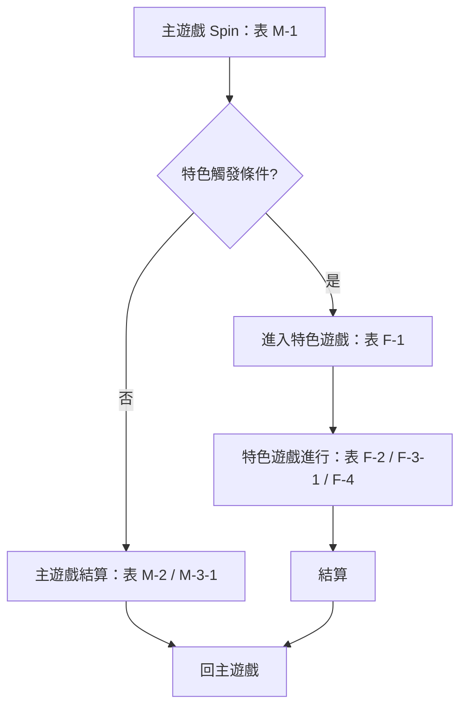

# 彌勒佛 機率規格書（Content 軌）

## 1. 規格簡述

### 基本規格

| 項目 | 值 | 來源 |
|---|---|---|
| 盤面 | 3x5 | 參數表 基本資訊 |
| 線數 | All Ways | 參數表 基本資訊 |
| 基本收費 | 132 | 參數表 基本資訊 |

### Pay table（odds × Line bet）

| 層級 | 符號 | x3 | x4 | x5 | 來源 |
|---|---|---|---|---|---|
| High Pay Symbols | M1 | 20 | 60 | 250 | 參數表 Odds表 |
| High Pay Symbols | M2 | 15 | 50 | 200 | 參數表 Odds表 |
| High Pay Symbols | M3 | 15 | 25 | 150 | 參數表 Odds表 |
| High Pay Symbols | M4 | 10 | 20 | 100 | 參數表 Odds表 |
| High Pay Symbols | M5 | 10 | 15 | 50 | 參數表 Odds表 |
| Low Pay Symbols | FA | 5 | 8 | 10 | 參數表 Odds表 |
| Low Pay Symbols | FK | 5 | 8 | 10 | 參數表 Odds表 |
| Low Pay Symbols | FQ | 5 | 8 | 10 | 參數表 Odds表 |

### xlsx「規格簡述」分頁（原文）

- **SPEC** 主遊戲
- **SPEC** 五輪 5*5  50lines
- **SPEC** 連線後如果有經過wild 則wild會進行乘倍抽選
- **SPEC** 免費遊戲
- **SPEC** 五輪 5*5　每行上方各有一個數字1
- **SPEC** 進行8手
- **SPEC** 如果轉出寶箱則會開出乘倍 將對應行數的數字做乘倍
- **SPEC** 8手結束後 上方數字相加最後程上line bet即是總獎金
- **SPEC** extrabet ｜ 左方每列初始也各有一個1
- **SPEC** 寶箱打開時 對應列數的數字也能乘倍

### 機率人員簡述

<!-- human:summary -->
（請以 2–4 句描述 彌勒佛 的主遊戲與特色觸發方式；此區重產保留）
<!-- /human -->

## 2. 數據資料

### 快測摘要

> 一表看完：總覽 KPI 與 RTP 組成圖由本表產生；值與下方各表相同來源。

| 指標 | 值 | 來源 |
|---|---|---|
| 總 RTP | 99.9395% | 數據資料 RTP 分項 |
| 主遊戲 RTP | 39.05% | 數據資料 RTP 分項 |
| 免費遊戲 RTP | 60.8895% | 數據資料 RTP 分項 |
| 主遊戲命中率 | 39.6931% | 數據資料 BASE INFO |
| 主遊戲最大倍數 | 368.18 | 數據資料 BASE INFO |
| FG 觸發率 | 0.4475% | 數據資料 BASE INFO |
| FG 平均觸發局數 | 223.47 | 數據資料 BASE INFO |
| FG 平均倍率 | 136.07 | 數據資料 BASE INFO |
| FG 最大倍數 | 31120.36 | 數據資料 BASE INFO |
| 總手數 | 1,000,000,000 | 數據資料 Workers 行 |
| 執行時間 | 2026-10-01 11:52 | 數據資料 版本行 |
| 引擎版本 | 1.0.0 | 數據資料 版本行 |
| 旗標 | 開MAXWIN | 數據資料 第一行 |
| golden RTP | 100.03% | 參數表 M-1 加權 |
| 誤差 | -0.088 pp | 計算 |
| 容許誤差 | 0.2 pp | P-000 |

### 快測基本資訊（BASE INFO）

| 階段 | RTP | Freq（每幾手） | Trigger % | 平均倍率 | PlayTimes | RetriRate | 最大倍率 |
|---|---|---|---|---|---|---|---|
| 主遊戲 | 39.0500% | 2.52 | 39.6931% | 0.98 | — | — | 368.18 |
| 免費遊戲 | 60.8895% | 223.47 | 0.4475% | 136.07 | 1.00 | 0.00% | 31120.36 |
| Feature | 0.0000% | — | 0.0000% | 0.00 | — | — | — |
| GRAND | 0.0000% | — | 0.0000% | 0.00 | — | — | — |
| 總計 | 99.9395% | — | — | — | — | — | — |

- 快測執行：總手數 1,000,000,000；執行時間 2026-10-01 11:52；旗標 開MAXWIN；耗時 252.87 s

- golden（參數表 M-1 加權 TOTAL RTP）：100.03%；實測總 RTP 99.9395%；誤差 -0.088 pp（容許 ± 0.2 pp）。**RTP 是模擬結果不是輸入**（P-000）。

### 主遊戲符號命中率

| 符號 | x1 | x2 | x3 | x4 | TOTAL |
|---|---|---|---|---|---|
| 11 | 0% | 1.01% | 0.38% | 0.1% | 1.49% |
| 12 | 0% | 1.52% | 0.81% | 0.21% | 2.54% |
| 13 | 0% | 3.9% | 3.34% | 2.47% | 9.7% |
| 14 | 0% | 12.76% | 5.65% | 1.67% | 20.08% |
| 15 | 0% | 7.56% | 2.42% | 1.29% | 11.27% |
| 21 | 0% | 0.5% | 0.18% | 0.06% | 0.73% |
| 22 | 0% | 1.05% | 0.35% | 0.11% | 1.5% |
| 23 | 0% | 0.33% | 0.08% | 0.02% | 0.43% |
| TOTAL | 0% | 28.63% | 13.19% | 5.93% | 47.75% |

### 主遊戲符號 RTP 貢獻

| 符號 | x1 | x2 | x3 | x4 | TOTAL |
|---|---|---|---|---|---|
| 11 | 0% | 0.31% | 0.46% | 0.65% | 1.42% |
| 12 | 0% | 0.47% | 1.05% | 1.41% | 2.93% |
| 13 | 0% | 0.99% | 2.29% | 19.35% | 22.63% |
| 14 | 0% | 1.75% | 2.09% | 4.12% | 7.95% |
| 15 | 0% | 1.14% | 0.82% | 2% | 3.96% |
| 21 | 0% | 0.02% | 0.01% | 0.01% | 0.04% |
| 22 | 0% | 0.05% | 0.03% | 0.01% | 0.09% |
| 23 | 0% | 0.01% | 0.01% | 0% | 0.02% |
| TOTAL | 0% | 4.75% | 6.76% | 27.55% | 39.05% |

### 輪帶組 RTP（理論 vs 實測）

| 組 | R1–R5 換帶 | 說明 | 權重 | 理論 Total RTP | 實測 Total RTP | 實測 FG RTP | 實測手數 |
|---|---|---|---|---|---|---|---|
| 0 | 0/0/0/0/0 | SC顆數最多12顆/會出現特殊SS | 40 | 242.264% | 233.6593% | 199.1367% | 40,001,298 |
| 1 | 0/0/0/1/0 | SC顆數最多12顆/會出現特殊SS | 100 | 127.4062% | 119.6897% | 80.8811% | 100,002,117 |
| 2 | 0/0/1/0/0 | SC顆數最多12顆/會出現特殊SS | 100 | 157.7854% | 148.3192% | 112.3896% | 100,002,539 |
| 3 | 0/1/0/0/0 | SC顆數最多12顆/會出現特殊SS | 100 | 162.0408% | 151.7361% | 113.3841% | 99,999,416 |
| 4 | 1/0/0/0/0 | SC顆數最多12顆/會出現特殊SS | 100 | 144.3309% | 135.7563% | 97.2436% | 100,004,414 |
| 5 | 0/0/0/0/1 | SC顆數最多12顆/不會出現特殊SS | 100 | 71.4701% | 86.4902% | 49.2749% | 100,004,039 |
| 6 | 0/0/0/1/1 | SC顆數最多12顆/不會出現特殊SS | 115 | 49.9947% | 53.7354% | 11.8999% | 115,004,320 |
| 7 | 0/0/1/0/1 | SC顆數最多12顆/不會出現特殊SS | 115 | 52.1205% | 58.0504% | 19.3% | 115,000,161 |
| 8 | 0/1/0/0/1 | SC顆數最多12顆/不會出現特殊SS | 115 | 54.4952% | 60.288% | 18.9553% | 114,975,048 |
| 9 | 1/0/0/0/1 | SC顆數最多12顆/不會出現特殊SS | 115 | 52.3806% | 57.3277% | 15.9817% | 115,006,648 |

### 贏分區間分布

| 贏分區間（倍） | 出現 Total | 出現 Main | 出現 Free | RTP Total | RTP Main | RTP Free |
|---|---|---|---|---|---|---|
| x = 0 | 59.89% | 60.31% | 0% | 0% | 0% | 0% |
| 0 < x < 1 | 33.2% | 33.23% | 0% | 8.69% | 8.69% | 0% |
| 1 <= x < 5 | 4.98% | 4.99% | 0% | 11.19% | 11.19% | 0% |
| 5 <= x < 10 | 0.77% | 0.77% | 0% | 5.47% | 5.47% | 0% |
| 10 <= x < 25 | 0.59% | 0.58% | 0% | 8.62% | 8.3% | 0% |
| 25 <= x < 50 | 0.18% | 0.1% | 0% | 6.53% | 3.48% | 0% |
| 50 <= x < 75 | 0.1% | 0.02% | 0% | 6.25% | 1.12% | 0% |
| 75 <= x < 100 | 0.07% | 0.01% | 0% | 6.07% | 0.45% | 0% |
| 100 <= x < 150 | 0.09% | 0% | 0% | 10.45% | 0.24% | 0% |
| 150 <= x < 200 | 0.05% | 0% | 0% | 8.03% | 0.1% | 0% |
| 200 <= x < 300 | 0.04% | 0% | 0% | 10.26% | 0.02% | 0% |
| 300 <= x < 500 | 0.02% | 0% | 0% | 8.02% | 0% | 0% |
| 500 <= x < 800 | 0.01% | 0% | 0% | 3.62% | 0% | 0% |
| 800 <= x < 1000 | 0% | 0% | 0% | 1.61% | 0% | 0% |
| 1000 <= x < 2000 | 0% | 0% | 0% | 3.9% | 0% | 0% |
| 2000 <= x < 5000 | 0% | 0% | 0% | 1.05% | 0% | 0% |
| 5000 <= x < 10000 | 0% | 0% | 0% | 0.15% | 0% | 0% |
| 10000 <= x < 20000 | 0% | 0% | 0% | 0.03% | 0% | 0% |
| 20000 <= x < 50000 | 0% | 0% | 0% | 0% | 0% | 0% |
| 50000 <= x < -1 | 0% | 0% | 0% | 0% | 0% | 0% |

### 倍數出現頻率

| 贏分區間（倍） | 約每幾局 | 累計門檻 | 累計約每幾局 |
|---|---|---|---|
| 0 < x < 1 | 3.01 | ≥ 0 | 14.48 |
| 1 <= x < 5 | 20.06 | ≥ 1 | 14.48 |
| 5 <= x < 10 | 130.14 | ≥ 5 | 52.02 |
| 10 <= x < 25 | 168.97 | ≥ 10 | 86.66 |
| 25 <= x < 50 | 543.28 | ≥ 25 | 177.9 |
| 50 <= x < 75 | 987.98 | ≥ 50 | 264.52 |
| 75 <= x < 100 | 1430.05 | ≥ 75 | 361.23 |
| 100 <= x < 150 | 1171.76 | ≥ 100 | 483.32 |
| 150 <= x < 200 | 2151.89 | ≥ 150 | 822.63 |
| 200 <= x < 300 | 2352.51 | ≥ 200 | 1331.74 |
| 300 <= x < 500 | 4629.37 | ≥ 300 | 3069.16 |
| 500 <= x < 800 | 17142.96 | ≥ 500 | 9106.64 |
| 800 <= x < 1000 | 55456.97 | ≥ 800 | 19426.15 |
| 1000 <= x < 2000 | 34237.2 | ≥ 1000 | 29899.84 |
| 2000 <= x < 5000 | 251445.81 | ≥ 2000 | 236016.05 |
| 5000 <= x < 10000 | 4291845.49 | ≥ 5000 | 3846153.85 |
| 10000 <= x < 20000 | 37037037.04 | ≥ 10000 | 37037037.04 |
| 20000 <= x < 50000 | 0 | ≥ 20000 | 0 |
| 50000 <= x < -1 | 0 | ≥ 50000 | 0 |

### 100 手資產分布

| 100 手後剩餘資產 | 佔比 |
|---|---|
| x <= 50 | 50.24% |
| 50 < x <= 100 | 21.27% |
| 100 < x <= 200 | 15.98% |
| 200 < x | 12.52% |

### 十分位

| 分位 | Total | Main | Free | F_Spin |
|---|---|---|---|---|
| D 1 | 0.0 | 0.0 | 35.4 | 0.0 |
| D 2 | 0.0 | 0.0 | 48.2 | 0.0 |
| D 3 | 0.0 | 0.0 | 61.0 | 0.0 |
| D 4 | 0.0 | 0.0 | 75.1 | 0.0 |
| D 5 | 0.0 | 0.0 | 91.7 | 0.0 |
| D 6 | 0.0 | 0.0 | 112.1 | 0.0 |
| D 7 | 0.1 | 0.1 | 139.6 | 0.0 |
| D 8 | 0.2 | 0.2 | 180.9 | 0.0 |
| D 9 | 0.6 | 0.5 | 259.2 | 0.0 |
| Maximum | 10000.0 | 368.2 | 31120.4 | 0.0 |
| Mean | 1.0 | 0.4 | 136.1 | 1.0 |
| S.D. | 15.1 |  |  |  |

### FG 強中弱實測分佈

| 組別 | F-1 權重 | 理論佔比 | 次數 | 實際佔比 | FG RTP 貢獻 |
|---|---|---|---|---|---|
| 超強 | 1 | 1.00% | 45,052 | 1.01% | 9.24% |
| 強 | 19 | 19.00% | 850,270 | 19.00% | 25.36% |
| 中 | 70 | 70.00% | 3,132,594 | 70.00% | 60.16% |
| 弱 | 10 | 10.00% | 446,978 | 9.99% | 5.24% |

### FG 詳細統計

| 項目 | 值 |
|---|---|
| FG 總觸發次數 | 4,474,894 |
| 平均初始基底（倍） | 15.73 |
| 全放 888 平均贏分（倍） | 846.67 |
| FG 平均贏分（倍） | 136.07 |
| FG 最大贏分（倍） | 31120.36 |
| 標準差 | 180.58 |
| 變異係數 | 1.33 |
| 平均總乘倍 | 5.21 |
| 平均金幣贏分 | 0.53 |
| 平均鯉魚贏分 | 8.5 |
| 全放 888 事件 | 25,539 次（佔 FG 0.5707%） |
| 每場平均金幣次數 | 2.4 |
| 每場平均鯉魚次數 | 3.62 |
| 每場平均金龍次數 | 3.01 |
| 每場平均彩龍次數 | 0.6 |

**FG 贏分貢獻拆解**

| 來源 | 佔比 |
|---|---|
| 初始基底 | 61.15% |
| 金幣 | 1.94% |
| 鯉魚 | 36.9% |
| 倍率放大 | 0% |

**觸發面：進場特殊符號顆數分布**

| 觸發顆數 | 次數 | 佔 FG |
|---|---|---|
| 6 顆 | 3,302,135 | 73.79% |
| 7 顆 | 900,157 | 20.12% |
| 8 顆 | 223,596 | 5% |
| 9 顆 | 40,601 | 0.91% |
| 10 顆 | 7,213 | 0.16% |
| 11 顆 | 1,088 | 0.02% |
| 12 顆 | 93 | 0% |
| 13 顆 | 10 | 0% |
| 14 顆 | 1 | 0% |

**各進場 SC 顆數 → 平均 FG 倍率**

| 進場 SC 顆數 | 次數 | 佔比 | 均 FG 倍率 |
|---|---|---|---|
| 3 顆 | 433,879 | 9.7% | 239.29 |
| 4 顆 | 849,507 | 18.98% | 198.66 |
| 5 顆 | 602,043 | 13.45% | 176.59 |
| 6 顆 | 2,024,284 | 45.24% | 87.47 |
| 7 顆 | 452,442 | 10.11% | 92.53 |
| 8 顆 | 98,677 | 2.21% | 97.95 |
| 9 顆 | 12,526 | 0.28% | 99.62 |
| 10 顆 | 1,354 | 0.03% | 103.37 |
| 11 顆 | 173 | 0% | 100.66 |
| 12 顆 | 9 | 0% | 82.22 |

**各組別詳細**

| 組別 | 次數 | 均金幣 | 均鯉魚 | 均金龍 | 均彩龍 | 均乘倍 | 均基底 | 均贏分 | 最大贏分 |
|---|---|---|---|---|---|---|---|---|---|
| 超強 | 45052 | 0.00 | 5.84 | 5.88 | 6.89 | 20.67 | 21.11 | 1248.31 | 31120.36 |
| 強 | 850270 | 2.00 | 4.55 | 3.89 | 0.85 | 6.59 | 16.80 | 181.62 | 14718.55 |
| 中 | 3132594 | 2.50 | 3.50 | 2.89 | 0.50 | 4.89 | 15.41 | 116.93 | 5750.06 |
| 弱 | 446978 | 2.75 | 2.50 | 1.89 | 0.20 | 3.29 | 15.43 | 71.44 | 4960.03 |

> 完整快測輸出見 prob-data.json `raw_log`（View 軌以摺疊區附上）；以上各表皆由同一份報表程式化轉出。

## 3. 機率流程圖



> 骨架由參數表的表編號自動帶出；分支條件與演出層請在下方「流程補充」補齊（重產保留）。

### 流程補充

<!-- human:flow-notes -->
（可在此放完整 mermaid 或逐步說明；每個節點標對應的表編號）
<!-- /human -->

## 4. 參數表

> 每一列的「來源」= xlsx 座標（分頁!儲存格 / 列）。數值為定案值（source: xlsx，pending_params 0）；有辨識的表（輪帶組 / 權重 / 雙欄 / 是否 / 矩陣 / 序列 / 單值）以契約表頭寫出，其餘照 xlsx 原樣。

### 基本資訊　盤面

### Odds表　Pay table

### 表 M-1　Main Game轉輪帶設定

| Index | R1 | R2 | R3 | R4 | R5 | 權重 | 組合說明 | TOTAL RTP | FG RTP | 來源 |
|---|---|---|---|---|---|---|---|---|---|---|
| 0 | 0 | 0 | 0 | 0 | 0 | 40 | SC顆數最多12顆/會出現特殊SS | 2.42264 | 2.076918 | 參數表!row22 |
| 1 | 0 | 0 | 0 | 1 | 0 | 100 | SC顆數最多12顆/會出現特殊SS | 1.274062 | 0.886124 | 參數表!row23 |
| 2 | 0 | 0 | 1 | 0 | 0 | 100 | SC顆數最多12顆/會出現特殊SS | 1.577854 | 1.217855 | 參數表!row24 |
| 3 | 0 | 1 | 0 | 0 | 0 | 100 | SC顆數最多12顆/會出現特殊SS | 1.620408 | 1.236401 | 參數表!row25 |
| 4 | 1 | 0 | 0 | 0 | 0 | 100 | SC顆數最多12顆/會出現特殊SS | 1.443309 | 1.057528 | 參數表!row26 |
| 5 | 0 | 0 | 0 | 0 | 1 | 100 | SC顆數最多12顆/不會出現特殊SS | 0.714701 | 0.342676 | 參數表!row27 |
| 6 | 0 | 0 | 0 | 1 | 1 | 115 | SC顆數最多12顆/不會出現特殊SS | 0.499947 | 0.081804 | 參數表!row28 |
| 7 | 0 | 0 | 1 | 0 | 1 | 115 | SC顆數最多12顆/不會出現特殊SS | 0.521205 | 0.134009 | 參數表!row29 |
| 8 | 0 | 1 | 0 | 0 | 1 | 115 | SC顆數最多12顆/不會出現特殊SS | 0.544952 | 0.131349 | 參數表!row30 |
| 9 | 1 | 0 | 0 | 0 | 1 | 115 | SC顆數最多12顆/不會出現特殊SS | 0.523806 | 0.110254 | 參數表!row31 |
| Σ |  |  |  |  |  | 1,000 |  | 1.0002786500000003 | 0.60973796 | 參數表!A20 |

### 表 M-2　假轉的SC/SS 或是 不會進FG的MG盤面，由下面表格抽取

| SC 倍數 | SC 權重 | SS 倍數 | SS 權重 | 來源 |
|---|---|---|---|---|
| 8 | 18 | 1,288 | 18 | 參數表!A36 |
| 18 | 16 | 1,888 | 16 | 參數表!A36 |
| 38 | 14 | 2,888 | 14 | 參數表!A36 |
| 68 | 12 | 3,888 | 12 | 參數表!A36 |
| 88 | 10 | 6,888 | 10 | 參數表!A36 |
| 188 | 8 | 8,888 | 8 | 參數表!A36 |
| 388 | 8 | *2 | 8 | 參數表!A36 |
| 688 | 8 | *3 | 8 | 參數表!A36 |
| 888 | 6 | *4 | 6 | 參數表!A36 |
| 均倍 181 | 100 | Σ | 100 | 參數表!A36 |

### 表 M-3-1　會進FG的盤面，根據組別過以下權重決定是否出現群預告

| 組別 | 是 | 否 | 來源 |
|---|---|---|---|
| 超強 | 100 | 0 | 參數表!A52 |
| 強 | 50 | 50 | 參數表!A52 |
| 中 | 0 | 100 | 參數表!A52 |
| 弱 | 0 | 100 | 參數表!A52 |

### 表 M-3-2　有群預告時，根據組別過以下權重決定SC是否全放888，若沒過則SC分數由M-5判斷

| 組別 | 是 | 否 | 來源 |
|---|---|---|---|
| 超強 | 10 | 90 | 參數表!A60 |
| 強 | 5 | 95 | 參數表!A60 |
| 中 | 0 | 100 | 參數表!A60 |
| 弱 | 0 | 100 | 參數表!A60 |

### 表 M-4　前四輪出現6顆以上SC，且第五輪至少有一顆SS時，過以下權重決定第五輪是否要變成彩色聽牌

| 項目 | 權重 | 備註 | 來源 |
|---|---|---|---|
| 是 | 50 |  | 參數表!A68 |
| 否 | 50 |  | 參數表!A68 |

### 表 M-5　進入FG時的 SC/SS的圖騰分數，由下面表格抽取

| SC 倍數 | SC 權重 | SS 倍數 | SS 權重 | 來源 |
|---|---|---|---|---|
| 8 | 250 | 1,288 | 400 | 參數表!A75 |
| 18 | 40 | 1,888 | 90 | 參數表!A75 |
| 38 | 60 | 2,888 | 60 | 參數表!A75 |
| 68 | 100 | 3,888 | 20 | 參數表!A75 |
| 88 | 450 | 6,888 | 7 | 參數表!A75 |
| 188 | 40 | 8,888 | 3 | 參數表!A75 |
| 388 | 7 | *2 | 220 | 參數表!A75 |
| 688 | 3 | *3 | 120 | 參數表!A75 |
| 888 | 50 | *4 | 80 | 參數表!A75 |
| 均倍 108.1 | 1,000 | Σ | 1,000 | 參數表!A75 |

### 表 F-1　決定強中弱組

| 項目 | 權重 | 備註 | 來源 |
|---|---|---|---|
| 超強 | 1 |  | 參數表!A92 |
| 強 | 19 |  | 參數表!A92 |
| 中 | 70 |  | 參數表!A92 |
| 弱 | 10 |  | 參數表!A92 |

### 表 F-2　FG 組別 → 金幣 / 鯉魚 / 金龍 / 彩龍 之出現次數與分數

**金幣・出現次數（權重）**

| 組別 | 0 | 1 | 2 | 3 | 4 | 5 | 權重和 | 平均次數 | 來源 |
|---|---|---|---|---|---|---|---|---|---|
| 超強 | 100 | 0 | 0 | 0 | 0 | 0 | 100 | 0 | 參數表!A101 |
| 強 | 0 | 25 | 50 | 25 | 0 | 0 | 100 | 2 | 參數表!A101 |
| 中 | 0 | 10 | 30 | 60 | 0 | 0 | 100 | 2.5 | 參數表!A101 |
| 弱 | 0 | 0 | 25 | 75 | 0 | 0 | 100 | 2.75 | 參數表!A101 |

**金幣・分數 Odds（權重）**

| 組別 | 18 | 38 | 68 | 88 | 權重和 | 平均分數 | 來源 |
|---|---|---|---|---|---|---|---|
| 超強 | 60 | 30 | 9 | 1 | 100 | 29.2 | 參數表!A101 |
| 強 | 60 | 30 | 9 | 1 | 100 | 29.2 | 參數表!A101 |
| 中 | 60 | 30 | 9 | 1 | 100 | 29.2 | 參數表!A101 |
| 弱 | 60 | 30 | 9 | 1 | 100 | 29.2 | 參數表!A101 |

**鯉魚・出現次數（權重）**

| 組別 | 0 | 1 | 2 | 3 | 4 | 5 | 6 | 7 | 8 | 9 | 10 | 權重和 | 平均次數 | 來源 |
|---|---|---|---|---|---|---|---|---|---|---|---|---|---|---|
| 超強 | 0 | 0 | 0 | 0 | 0 | 50 | 30 | 10 | 6 | 3 | 1 | 100 | 5.85 | 參數表!A101 |
| 強 | 0 | 0 | 0 | 25 | 35 | 20 | 10 | 6 | 3 | 1 | 0 | 100 | 4.5 | 參數表!A101 |
| 中 | 0 | 0 | 20 | 30 | 30 | 20 | 0 | 0 | 0 | 0 | 0 | 100 | 3.5 | 參數表!A101 |
| 弱 | 0 | 0 | 60 | 30 | 10 | 0 | 0 | 0 | 0 | 0 | 0 | 100 | 2.5 | 參數表!A101 |

**鯉魚・分數 Odds（權重）**

| 組別 | 188 | 388 | 688 | 888 | 權重和 | 平均分數 | 來源 |
|---|---|---|---|---|---|---|---|
| 超強 | 0 | 0 | 0 | 100 | 100 | 888 | 參數表!A101 |
| 強 | 60 | 30 | 9 | 1 | 100 | 300 | 參數表!A101 |
| 中 | 60 | 30 | 9 | 1 | 100 | 300 | 參數表!A101 |
| 弱 | 60 | 30 | 9 | 1 | 100 | 300 | 參數表!A101 |

**金龍・出現次數（權重，倍數固定 ×1）**

| 組別 | 0 | 1 | 2 | 3 | 4 | 5 | 6 | 7 | 8 | 9 | 10 | 11 | 12 | 13 | 14 | 15 | 16 | 17 | 18 | 19 | 20 | 權重和 | 平均倍數 | 來源 |
|---|---|---|---|---|---|---|---|---|---|---|---|---|---|---|---|---|---|---|---|---|---|---|---|---|
| 超強 | 0 | 0 | 0 | 0 | 0 | 5,000 | 3,000 | 1,000 | 500 | 300 | 100 | 50 | 30 | 10 | 6 | 3 | 1 | 0 | 0 | 0 | 0 | 10,000 | 5.8885 | 參數表!A101 |
| 強 | 0 | 0 | 0 | 5,000 | 3,000 | 1,000 | 500 | 300 | 100 | 50 | 30 | 10 | 6 | 3 | 1 | 0 | 0 | 0 | 0 | 0 | 0 | 10,000 | 3.8885 | 參數表!A101 |
| 中 | 0 | 0 | 5,000 | 3,000 | 1,000 | 500 | 300 | 100 | 50 | 30 | 10 | 6 | 3 | 1 | 0 | 0 | 0 | 0 | 0 | 0 | 0 | 10,000 | 2.8885 | 參數表!A101 |
| 弱 | 0 | 5,000 | 3,000 | 1,000 | 500 | 300 | 100 | 50 | 30 | 10 | 6 | 3 | 1 | 0 | 0 | 0 | 0 | 0 | 0 | 0 | 0 | 10,000 | 1.8885 | 參數表!A101 |

**彩龍・出現次數（權重，倍數固定 ×2）**

| 組別 | 0 | 1 | 2 | 3 | 4 | 5 | 6 | 7 | 8 | 9 | 10 | 11 | 12 | 13 | 14 | 15 | 16 | 17 | 18 | 19 | 20 | 權重和 | 平均倍數 | 來源 |
|---|---|---|---|---|---|---|---|---|---|---|---|---|---|---|---|---|---|---|---|---|---|---|---|---|
| 超強 | 0 | 0 | 0 | 0 | 0 | 0 | 5,000 | 3,000 | 1,000 | 500 | 300 | 100 | 50 | 30 | 10 | 6 | 3 | 1 | 0 | 0 | 0 | 10,000 | 13.777 | 參數表!A101 |
| 強 | 50 | 30 | 10 | 6 | 3 | 1 | 0 | 0 | 0 | 0 | 0 | 0 | 0 | 0 | 0 | 0 | 0 | 0 | 0 | 0 | 0 | 100 | 1.7 | 參數表!A101 |
| 中 | 60 | 30 | 10 | 0 | 0 | 0 | 0 | 0 | 0 | 0 | 0 | 0 | 0 | 0 | 0 | 0 | 0 | 0 | 0 | 0 | 0 | 100 | 1 | 參數表!A101 |
| 弱 | 80 | 20 | 0 | 0 | 0 | 0 | 0 | 0 | 0 | 0 | 0 | 0 | 0 | 0 | 0 | 0 | 0 | 0 | 0 | 0 | 0 | 100 | 0.4 | 參數表!A101 |

### 表 F-3-1　表演過以下權重，決定出場順序

| 項目 | 金幣 | 鯉魚 | 金龍 | 彩龍 | Total | 來源 |
|---|---|---|---|---|---|---|
| 前兩次抽取 | 80 | 15 | 5 | 0 | 100 | 參數表!A177 |
| 第三次以後 | 60 | 30 | 7 | 3 | 100 | 參數表!A177 |

### 表 F-4　FG復活參數

### 表 F-4-1　超過多少倍有機會觸發復活

| 項目 | 值 | 來源 |
|---|---|---|
| 倍數 | 300 | 參數表!A188 |

### 表 F-4-2　決定是否觸發復活

| 項目 | 權重 | 備註 | 來源 |
|---|---|---|---|
| 是 | 50 |  | 參數表!A193 |
| 否 | 50 |  | 參數表!A193 |

### 表 F-4-3　根據以下權重，決定要保留幾條龍

| 保留金龍 | 0 | 1 | 2 | 3 | 4 | 5 | 6 | 7 | 8 | 9 | 10 | 11 | 來源 |
|---|---|---|---|---|---|---|---|---|---|---|---|---|---|
| 權重 | 0 | 0 | 45 | 40 | 10 | 5 | 0 | 0 | 0 | 0 | 0 | 0 | 參數表!A198 |

| 保留彩龍 | 0 | 1 | 2 | 3 | 4 | 5 | 6 | 7 | 來源 |
|---|---|---|---|---|---|---|---|---|---|
| 權重 | 0 | 45 | 40 | 10 | 5 | 0 | 0 | 0 | 參數表!A198 |

### 表 F-5　FG彩字倍數門檻

| 項目 | 值 | 來源 |
|---|---|---|
| FG彩字倍數門檻 | 200 | 參數表!A208 |

### 參數備註

<!-- human:param-notes -->
（參數語意、旋鈕用途、與設定檔鍵名對照；重產保留）
<!-- /human -->

## 5. 競品資料／手法對應

<!-- human:competitor -->
| 機制（參數表） | 說明 | 對應手法卡 | 收錄目的 |
|---|---|---|---|
| 表 M-1 | Main Game轉輪帶設定 |  |  |
| 表 M-2 | 假轉的SC/SS 或是 不會進FG的MG盤面，由下面表格抽取 |  |  |
| 表 M-3-1 | 會進FG的盤面，根據組別過以下權重決定是否出現群預告 |  |  |
| 表 M-3-2 | 有群預告時，根據組別過以下權重決定SC是否全放888，若沒過則SC分數由M-5判斷 |  |  |
| 表 M-4 | 前四輪出現6顆以上SC，且第五輪至少有一顆SS時，過以下權重決定第五輪是否要變成彩色聽牌 |  |  |
| 表 M-5 | 進入FG時的 SC/SS的圖騰分數，由下面表格抽取 |  |  |
| 表 F-1 | 決定強中弱組 |  |  |
| 表 F-2 | FG 組別 → 金幣 / 鯉魚 / 金龍 / 彩龍 之出現次數與分數 |  |  |
| 表 F-3-1 | 表演過以下權重，決定出場順序 |  |  |
| 表 F-4 | FG復活參數 |  |  |
| 表 F-4-1 | 超過多少倍有機會觸發復活 |  |  |
| 表 F-4-2 | 決定是否觸發復活 |  |  |
| 表 F-4-3 | 根據以下權重，決定要保留幾條龍 |  |  |
| 表 F-5 | FG彩字倍數門檻 |  |  |

<!-- /human -->

## 6. 隱性規則

### xlsx「隱性規則」分頁

- **SPEC** 編號 ｜ 情況 ｜ 說明
- **SPEC** Main Game
- **SPEC** 1
- **SPEC** 2
- **SPEC** 3
- **SPEC** Free Game
- **SPEC** 1 ｜ 全盤, 一直行, 一橫列, 一斜排 等特殊情況 只會在第一手出現 ｜ 因為後面因為上線保護 而某些格出不了會很奇怪 所以只在第一手出 / 且第一手出也可以讓玩家意識到是super free game
- **SPEC** 2 ｜ (extra)上方+左方 (no extra上方) 分數超過 750000時 該格不會再轉出寶箱 ｜ 上限保護
- **SPEC** 3 ｜ (extra)該格上方+左方分數大於等於 / (noextra)該格上方+左方分數大於等於 / 75000: 不會出*20 / 150000: 不會出 *10 *20 / 300000: 不會出 *5 *10 *20 / 500000: 不會出 *3 *5 *10 *20 ｜ 上限保護
- **SPEC** 特殊音寶箱只會出乘20 且 上+左的分數 >= 10 (no extra 只看上方) ｜ 讓玩家能清楚了解到提前宣告, >=的分數是用來控制出現率的 (不拉是怕出現率太低) 目前抓10次free game會遇到1次
- **SPEC** 5
- **SPEC** Feature Game
- **SPEC** 1
- **SPEC** 2
- **SPEC** 3

<!-- human:hidden-rules -->
| 規則 | 設計目的 | 對應表 / K 卡 | 更改需同步 |
|---|---|---|---|
| （例）復活為演出層攔截，不改 RTP | 製造起死回生張力 | 表 F-4 / K-021 | 編導規格書 |

<!-- /human -->

## 輪帶 Strip（附錄）

> 來源：xlsx Strip 分頁（ps_extract parse_strips）；顆數由帶面逐格計數，帶面每軸一行、由上而下。

### main_strip / Reels_0

| 組 | 軸 | 長度 | M1 | M2 | M3 | M4 | M5 | WW | SC | SS | FA | FK | FQ |
|---|---|---|---|---|---|---|---|---|---|---|---|---|---|
| main_strip / Reels_0 | R1 | 126 | 10 | 18 | 21 | 27 | 24 | 0 | 12 | 0 | 4 | 6 | 4 |
| main_strip / Reels_0 | R2 | 188 | 16 | 12 | 38 | 36 | 29 | 8 | 13 | 0 | 14 | 14 | 8 |
| main_strip / Reels_0 | R3 | 160 | 10 | 20 | 24 | 34 | 28 | 6 | 12 | 0 | 8 | 14 | 4 |
| main_strip / Reels_0 | R4 | 112 | 10 | 12 | 29 | 12 | 12 | 6 | 13 | 0 | 8 | 6 | 4 |
| main_strip / Reels_0 | R5 | 133 | 12 | 12 | 34 | 12 | 17 | 0 | 0 | 12 | 12 | 12 | 10 |

```strip
# main_strip / Reels_0
R1: M4 M4 M4 FQ M3 M3 M3 SC SC M1 M1 M1 FK M2 M2 FA M5 FK M4 FQ M5 FK M2 M5 M4 M2 M4 FA M5 SC SC M4 M4 M4 M5 M1 M3 M4 M5 M3 M4 M2 M1 M3 M4 M5 M3 M4 M2 M5 M4 M4 M5 M2 M2 M2 M3 M5 M5 M5 SC SC SC M3 M3 M3 FQ M3 M3 M3 SC SC M1 M1 M1 FK M2 M2 FA M5 FK M4 FQ M5 FK M2 M5 M4 M2 M4 FA M5 M3 M3 M4 M4 M4 M5 M1 M3 M4 M5 M3 M4 M2 M1 M3 M4 M5 M3 M4 M2 M5 M4 M4 M5 M2 M2 M2 M3 M5 M5 M5 SC SC SC
R2: M2 M2 M2 M1 M5 M2 M2 M2 SC SC SC FA M4 M5 FQ FK M4 FQ M5 M4 M3 FK M5 M4 FA M5 WW M3 M3 FK M4 M1 M3 M4 FA M3 FQ M5 M4 M3 FK M5 M4 FA M5 WW M3 M3 FK M4 M1 M3 M4 FA M3 FQ M5 M4 M3 FK M5 M4 FA M5 WW M3 M3 FK M4 M1 M3 M4 M5 SC SC M1 M1 M1 M4 M3 M3 M3 M4 M4 M4 WW M1 FA M3 M3 M5 SC SC SC M2 M2 M2 M1 M5 M2 M2 M2 M5 M5 M5 FA M4 M5 FQ FK M4 FQ M5 M4 M3 FK M5 M4 FA M5 WW M3 M3 FK M4 M1 M3 M4 FA M3 FQ M5 M4 M3 FK M5 M4 FA M5 WW M3 M3 FK M4 M1 M3 M4 FA M3 FQ M5 M4 M3 FK M5 M4 FA M5 WW M3 M3 FK M4 M1 M3 M4 M5 SC SC M1 M1 M1 M4 M3 M3 M3 M4 M4 M4 WW M1 FA M3 M3 M5 SC SC SC
R3: M5 M5 M5 M4 M3 SC SC M4 M4 M4 M2 M2 M2 WW M5 FK M2 M1 M4 M3 SC SC SC FK FK FK M4 M3 M5 M5 M4 M4 M4 M2 M2 M2 WW M5 FK SC SC M4 M4 M3 M3 M3 M3 M2 M3 M3 M4 FK M5 FA M4 M5 FA M3 M5 M5 M5 FQ M2 WW M5 FA FK M1 M1 M1 M4 M4 FQ M3 FA M4 M3 M1 M2 M4 M5 M5 M5 M4 M3 M5 M5 M4 M4 M4 M2 M2 M2 WW M5 FK M2 M1 M4 M3 SC SC SC FK FK FK M4 M3 M5 M5 M4 M4 M4 M2 M2 M2 WW M5 FK SC SC M4 M4 M3 M3 M3 M3 M2 M3 M3 M4 FK M5 FA M4 M5 FA M3 M5 M5 M5 FQ M2 WW M5 FA FK M1 M1 M1 M4 M4 FQ M3 FA M4 M3 M1 M2 M4
R4: M3 M3 M3 M3 M3 M3 M3 SC SC SC M1 WW FQ M5 FK M3 M3 M3 M4 M4 FA M2 WW M5 FK M3 M2 M2 SC SC M1 M1 M1 FA FK M3 M2 FA WW M5 M4 M2 FQ M3 M4 M4 M4 M2 M1 M5 M5 M5 FA SC SC SC M3 M3 M3 M3 M3 M3 M3 M3 M3 M3 M1 WW FQ M5 FK M3 M3 M3 M4 M4 FA M2 WW M5 FK M3 M2 M2 SC SC M1 M1 M1 FA FK M3 M2 FA WW M5 M4 M2 FQ M3 M4 M4 M4 M2 M1 M5 M5 M5 FA SC SC SC
R5: M3 M3 M3 M3 M3 M3 M3 M3 M3 M3 M3 M5 M5 M1 M1 M1 SS SS M5 M3 FA M2 FA M1 FQ SS SS SS FA M1 FK M2 FQ FK M4 M4 M4 FA M3 M3 M3 FA M5 FK M3 M5 M1 M5 FK M4 FK M3 FK M2 FQ M5 M5 M4 FQ FA M4 FQ M2 M2 M2 SS SS SS M3 M3 M3 M3 M3 M3 M3 M3 M3 M3 M3 M5 M5 M1 M1 M1 SS SS M5 M3 FA M2 FA M1 FQ M5 M5 M5 FA M1 FK M2 FQ FK M4 M4 M4 FA M3 M3 M3 FA M5 FK M3 M5 M1 M5 FK M4 FK M3 FK M2 FQ SS SS M4 FQ FA M4 FQ M2 M2 M2
```

### main_strip / Reels_1

| 組 | 軸 | 長度 | M1 | M2 | M3 | M4 | M5 | WW | FA | FK | FQ |
|---|---|---|---|---|---|---|---|---|---|---|---|
| main_strip / Reels_1 | R1 | 126 | 13 | 20 | 23 | 32 | 24 | 0 | 4 | 6 | 4 |
| main_strip / Reels_1 | R2 | 188 | 16 | 12 | 45 | 39 | 32 | 8 | 14 | 14 | 8 |
| main_strip / Reels_1 | R3 | 160 | 12 | 23 | 24 | 37 | 32 | 6 | 8 | 14 | 4 |
| main_strip / Reels_1 | R4 | 112 | 10 | 15 | 35 | 14 | 14 | 6 | 8 | 6 | 4 |
| main_strip / Reels_1 | R5 | 136 | 12 | 12 | 38 | 15 | 25 | 0 | 12 | 12 | 10 |

```strip
# main_strip / Reels_1
R1: M4 M4 M4 FQ M3 M3 M3 M4 M4 M1 M1 M1 FK M2 M2 FA M5 FK M4 FQ M5 FK M2 M5 M4 M2 M4 FA M5 M3 M3 M4 M4 M4 M5 M1 M3 M4 M5 M3 M4 M2 M1 M3 M4 M5 M3 M4 M2 M5 M4 M4 M5 M2 M2 M2 M3 M5 M5 M5 M4 M4 M4 M3 M3 M3 FQ M3 M3 M3 M2 M2 M1 M1 M1 FK M2 M2 FA M5 FK M4 FQ M5 FK M2 M5 M4 M2 M4 FA M5 M3 M3 M4 M4 M4 M5 M1 M3 M4 M5 M3 M4 M2 M1 M3 M4 M5 M3 M4 M2 M5 M4 M4 M5 M2 M2 M2 M3 M5 M5 M5 M1 M1 M1
R2: M2 M2 M2 M1 M5 M2 M2 M2 M5 M5 M5 FA M4 M5 FQ FK M4 FQ M5 M4 M3 FK M5 M4 FA M5 WW M3 M3 FK M4 M1 M3 M4 FA M3 FQ M5 M4 M3 FK M5 M4 FA M5 WW M3 M3 FK M4 M1 M3 M4 FA M3 FQ M5 M4 M3 FK M5 M4 FA M5 WW M3 M3 FK M4 M1 M3 M4 M5 M3 M3 M1 M1 M1 M4 M3 M3 M3 M4 M4 M4 WW M1 FA M3 M3 M5 M4 M4 M4 M2 M2 M2 M1 M5 M2 M2 M2 M5 M5 M5 FA M4 M5 FQ FK M4 FQ M5 M4 M3 FK M5 M4 FA M5 WW M3 M3 FK M4 M1 M3 M4 FA M3 FQ M5 M4 M3 FK M5 M4 FA M5 WW M3 M3 FK M4 M1 M3 M4 FA M3 FQ M5 M4 M3 FK M5 M4 FA M5 WW M3 M3 FK M4 M1 M3 M4 M5 M3 M3 M1 M1 M1 M4 M3 M3 M3 M4 M4 M4 WW M1 FA M3 M3 M5 M3 M3 M3
R3: M5 M5 M5 M4 M3 M5 M5 M4 M4 M4 M2 M2 M2 WW M5 FK M2 M1 M4 M3 M4 M4 M4 FK FK FK M4 M3 M5 M5 M4 M4 M4 M2 M2 M2 WW M5 FK M5 M5 M4 M4 M3 M3 M3 M3 M2 M3 M3 M4 FK M5 FA M4 M5 FA M3 M5 M5 M5 FQ M2 WW M5 FA FK M1 M1 M1 M4 M4 FQ M3 FA M4 M3 M1 M2 M4 M5 M5 M5 M4 M3 M5 M5 M4 M4 M4 M2 M2 M2 WW M5 FK M2 M1 M4 M3 M2 M2 M2 FK FK FK M4 M3 M5 M5 M4 M4 M4 M2 M2 M2 WW M5 FK M1 M1 M4 M4 M3 M3 M3 M3 M2 M3 M3 M4 FK M5 FA M4 M5 FA M3 M5 M5 M5 FQ M2 WW M5 FA FK M1 M1 M1 M4 M4 FQ M3 FA M4 M3 M1 M2 M4
R4: M3 M3 M3 M3 M3 M3 M3 M3 M3 M3 M1 WW FQ M5 FK M3 M3 M3 M4 M4 FA M2 WW M5 FK M3 M2 M2 M5 M5 M1 M1 M1 FA FK M3 M2 FA WW M5 M4 M2 FQ M3 M4 M4 M4 M2 M1 M5 M5 M5 FA M2 M2 M2 M3 M3 M3 M3 M3 M3 M3 M3 M3 M3 M1 WW FQ M5 FK M3 M3 M3 M4 M4 FA M2 WW M5 FK M3 M2 M2 M4 M4 M1 M1 M1 FA FK M3 M2 FA WW M5 M4 M2 FQ M3 M4 M4 M4 M2 M1 M5 M5 M5 FA M3 M3 M3
R5: M3 M3 M3 M3 M3 M3 M3 M3 M3 M3 M3 M5 M5 M1 M1 M1 M3 M3 M5 M3 FA M2 FA M1 FQ M5 M5 M5 FA M1 FK M2 FQ FK M4 M4 M4 FA M3 M3 M3 FA M5 FK M3 M5 M1 M5 FK M4 FK M3 FK M2 FQ M5 M5 M4 FQ FA M4 FQ M2 M2 M2 M5 M5 M5 M3 M3 M3 M3 M3 M3 M3 M3 M3 M3 M3 M5 M5 M1 M1 M1 M3 M3 M5 M3 FA M2 FA M1 FQ M5 M5 M5 FA M1 FK M2 FQ FK M4 M4 M4 FA M3 M3 M3 FA M5 FK M3 M5 M1 M5 FK M4 FK M3 FK M2 FQ M5 M5 M4 FQ FA M4 FQ M2 M2 M2 M4 M4 M4
```

### main_strip / 假轉

| 組 | 軸 | 長度 | M1 | M2 | M3 | M4 | M5 | WW | SC | SS | FA | FK | FQ |
|---|---|---|---|---|---|---|---|---|---|---|---|---|---|
| main_strip / 假轉 | R1 | 45 | 3 | 5 | 3 | 7 | 14 | 0 | 5 | 0 | 2 | 4 | 2 |
| main_strip / 假轉 | R2 | 41 | 3 | 4 | 6 | 3 | 12 | 3 | 5 | 0 | 3 | 1 | 1 |
| main_strip / 假轉 | R3 | 42 | 5 | 4 | 4 | 3 | 12 | 3 | 5 | 0 | 0 | 3 | 3 |
| main_strip / 假轉 | R4 | 37 | 2 | 3 | 5 | 5 | 7 | 2 | 5 | 0 | 3 | 3 | 2 |
| main_strip / 假轉 | R5 | 38 | 4 | 4 | 5 | 5 | 3 | 0 | 0 | 5 | 4 | 4 | 4 |

```strip
# main_strip / 假轉
R1: M4 M4 M4 M5 FA M5 M5 M5 M4 M4 M5 M4 SC SC SC M5 M5 M5 M2 M2 M2 M5 FK M5 M5 M5 FQ M3 M3 M3 SC SC M1 M1 M1 FK M2 M2 FA M5 FK M4 FQ M5 FK
R2: M2 M5 M5 WW M2 M2 M5 M5 M2 M5 FK M5 FA M5 M5 M5 WW M1 M1 SC SC SC M3 M3 M5 FQ M3 FA M3 M5 M4 M4 M4 WW M1 FA M3 M3 M5 SC SC
R3: FQ M5 FK M4 M5 M5 M5 FQ M5 WW M5 SC SC SC M1 M1 M1 WW M5 FQ M1 M5 M5 M4 M3 FK M5 M3 M3 M5 M2 M2 M2 WW M5 FK M2 M1 M4 M3 SC SC
R4: M4 M4 M4 M1 M1 M5 M5 M5 FA SC SC SC FQ M5 FK M3 M3 M3 FA M4 M4 WW FA M2 M5 WW M5 FK M3 FQ M5 FK M3 M2 M2 SC SC
R5: M4 M4 M4 FA M3 M3 M3 FA FK M3 M1 SS SS SS M5 M5 FQ M4 FK FA M3 FQ FK M2 FQ M5 FK M4 FQ FA M2 M2 M2 SS SS M1 M1 M1
```

### fake_strip / 假轉

| 組 | 軸 | 長度 | M1 | M2 | M3 | M4 | M5 | G1 | GW | S1 | YW |
|---|---|---|---|---|---|---|---|---|---|---|---|
| fake_strip / 假轉 | R1 | 60 | 6 | 11 | 8 | 10 | 16 | 1 | 5 | 1 | 2 |
| fake_strip / 假轉 | R2 | 60 | 4 | 6 | 14 | 6 | 21 | 1 | 5 | 1 | 2 |
| fake_strip / 假轉 | R3 | 60 | 6 | 4 | 12 | 8 | 21 | 1 | 5 | 1 | 2 |
| fake_strip / 假轉 | R4 | 60 | 6 | 14 | 10 | 4 | 17 | 1 | 5 | 1 | 2 |
| fake_strip / 假轉 | R5 | 60 | 8 | 2 | 10 | 8 | 23 | 1 | 5 | 1 | 2 |

```strip
# fake_strip / 假轉
R1: M5 M2 GW M4 M5 M1 M1 M1 M2 M2 GW M4 M3 M3 M3 M4 YW M5 M4 M2 M5 M5 M2 G1 M4 M5 M5 M5 M3 GW M5 M2 M2 M4 M5 M1 M1 M1 M2 M2 GW M4 M3 M3 M3 M4 YW M5 M4 M2 M5 M5 M2 S1 M4 M5 M5 M5 M3 GW
R2: M5 M3 M4 M4 S1 M2 M2 M5 M5 M5 YW M2 M5 M3 M3 M5 G1 M1 M1 M3 M3 M4 M4 GW M5 M5 M5 GW M3 M3 M5 M3 M5 M5 M5 M2 M2 M5 M5 M5 GW M2 M5 M3 M3 M5 YW M1 M1 M3 M3 M4 M4 GW M5 M5 M5 GW M3 M3
R3: M4 M4 M5 M5 GW M5 M4 M3 M5 GW M3 M3 M3 M5 M5 M5 YW M3 M5 M5 M3 M4 M2 M5 M2 M5 M1 M1 M1 S1 M4 M4 M5 M5 GW M5 M4 M3 M5 GW M3 M3 M3 M5 M5 M5 YW M3 M5 M5 M3 M4 M2 G1 M2 M5 M1 M1 M1 GW
R4: M4 M1 M1 M5 M2 M2 M5 M5 G1 M2 M2 M3 M3 M3 M5 YW M5 M2 M2 M3 M3 M1 M4 GW M2 M5 M5 M5 GW M5 M4 M1 M1 S1 M2 M2 M5 M5 GW M2 M2 M3 M3 M3 M5 YW M5 M2 M2 M3 M3 M1 M4 GW M2 M5 M5 M5 GW M5
R5: M3 M3 GW M4 M1 M1 M4 M3 M5 M1 GW M5 M5 M3 M5 M2 S1 M5 M5 M5 M5 M5 M4 M3 YW M5 M5 M4 M1 M5 M3 M3 GW M4 M1 M1 M4 M3 M5 M1 GW M5 M5 M3 M5 M2 G1 M5 M5 M5 M5 M5 M4 M3 YW M5 M5 M4 M1 GW
```

## 邊界聲明

- 來源：`彌勒佛機率表_v3_1001A版.xlsx`（sha256:408fa27462d5b3a1）；本檔由 ark-game-prob ps_extract → ps_probspec 程式化轉出，數字未經手抄。
- 人工區（`<!-- human:… -->`）由機率人員撰寫；重產時原文保留；人工區內的數字不受 PS-NUM 保護，請自行標來源。
- xlsx「規格簡述」「隱性規則」分頁若為樣板殘留，請回填 xlsx 後重產；本檔不替人判斷。
