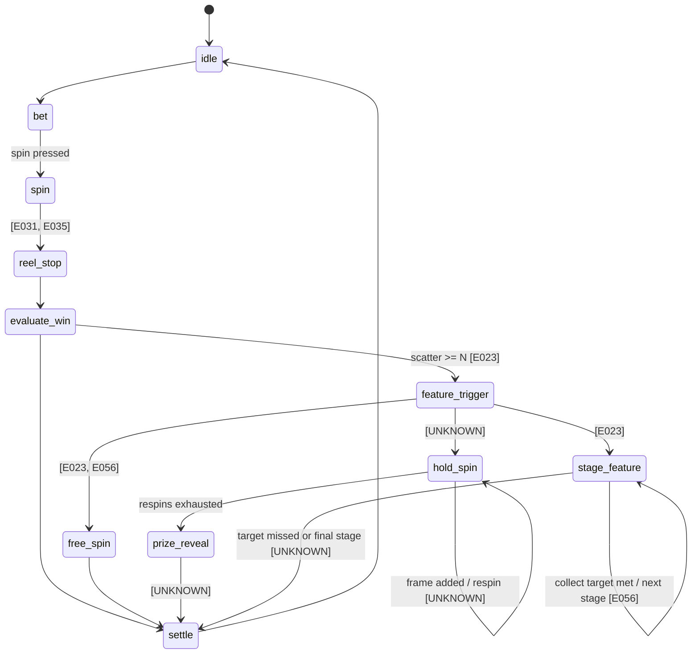

# 機率規格書：Huff N' Puff Open House

> 依機率規格書公版「製作方針」六段組成；**SPEC** = 規格書、**DECIDED** = 決議、**FROM_KB** = 知識庫、待決議 = 未決議（null）。人工填寫區可直接編輯，重產保留。
## 1. 規格簡述

### 基本規格

| 項目 | 內容 | 來源 |
|---|---|---|
| 盤面 | 3×5（主遊戲） | **SPEC** gdd.yaml.spec |
| Free Game | N | **SPEC** gdd.yaml.spec |
| JP（彩金） | Y | **SPEC** gdd.yaml.spec |
| 機種名 | Huff N' Puff Open House | **SPEC** gdd.yaml.spec |
| 版型 | portrait | **SPEC** gdd.yaml.spec |

### 主遊戲

**遊戲概述（Game Overview）**

- **SPEC** **OBSERVED**
- **SPEC** `game.title` = Huff N' Puff Open House — evidence: E001, E003, E028 — confidence: high
- **SPEC** **INFERRED**
- **SPEC** `game.theme` = Three Little Pigs — evidence: E004, E007, E018, E031 — reasoning: Inferred from the game title 'Huff N' Puff' and visual elements including pigs, a wolf, construction tools, and straw/stick/brick houses based on the Three Little Pigs story. — confidence: high
- **SPEC** `game.type` = video slot — evidence: E023, E031, E035 — reasoning: Inferred from the 5x3 spinning reel grid display and digital UI features. — confidence: high
- **SPEC** `game.platform` = cabinet — evidence: E003, E008, E019 — reasoning: Inferred from descriptions of physical casino slot cabinet structures such as upper top screens, curved displays, and physical bezel layouts. — confidence: high
- **SPEC** `game.orientation` = portrait — evidence: E003, E008, E019 — reasoning: Inferred from the vertically arranged layout with jackpot meters on the top screen, thematic visuals in the middle, and main reels at the bottom. — confidence: high

**遊戲流程（Game Flow）**

- **SPEC** **OBSERVED**
- **SPEC** `flow.states` = [idle, play, result, settle, feature] — evidence: E001, E013, E014, E015, E022, E054, E056 — confidence: high
- **SPEC** `flow.entry_state` = idle — evidence: E001, E013 — confidence: high
- **SPEC** `flow.feature_trigger_present` = true — evidence: E054, E056, E066 — confidence: high
- **SPEC** `flow.settlement_visible` = true — evidence: E022, E041, E049 — confidence: high
- **SPEC** **FROM_KB**
- **SPEC** `GKB-CORE-TRIGGER-001` 計數累積型觸發（collect-to-trigger） — tags: game-loop, reward, trigger — trust: deterministic
- **SPEC** `GKB-FISH-BOSS-001` Boss 魚出場與分段獎勵 — tags: reward, trigger — trust: deterministic — cross-domain
- **SPEC** `GKB-CORE-BONUS-001` 轉盤 Bonus 通用 pattern — tags: reward — trust: deterministic

**核心規則（Core Rules）**

- **SPEC** **DECIDED**
- **SPEC** `core_rules` = 5×3 REEL WAYS（243 Ways，左到右）。大野狼 WILD 出現於第 2～5 軸。四種建材 Scatter（稻草／木頭／磚頭／金條）：單顆依機率觸發對應 House Spin（Straw／Stick／Brick／Palace），同手多種同時觸發依 金條→磚→木頭→稻草 只進一個；四種合計 ≥ 6 顆觸發 Open House Feature，且優先於單顆觸發；6 頂安全帽觸發 Free Games（內容 deferred，v1 不實作）。House Spin：起始框依權重抽 2～5 框，3 次重轉，有新框補回 3 次，框內安全帽在相鄰空格新增同材質框（K-019 漸進封頂，實體上限 15 格，見 D021），結束時框翻成房子、大野狼吹開揭獎累加。Open House：起始框＝觸發建材位置與材質；依序稻草屋→木屋→磚屋→宮殿，每房 6 次，鑰匙需求 6／5／4／3；每框最多 1 把鑰匙、集滿後不再出、仍轉完剩餘次數；換房只保留出過鑰匙的框並統一為該房等級；框內安全帽先升自己，已是宮殿依 金磚→木→稻草 升其他框，都沒有則空位新增框，15 格全宮殿無效；同手框內安全帽 ≥ 3 顆本房 +1 手（只加 1）；次數不因收集重置；每房結束時框格結算，未集滿則 Feature 結束；宮殿集滿 3 把只留出過鑰匙的框再玩宮殿，不設上限（程式防呆 1,000 輪）。觀察修正（analysis OBSERVED 不完整處，以本決議為準）：stage_feature.collect_targets 實為 [6,5,4,3]；free_spin.present 應為 true（跑馬燈 A 11:13，內容未拍到）；scatter.trigger_target 實為 House Spin × 4 與 Open House。影片為 Demo Mode，觸發頻率不作機率依據。 — decision: D001 — rationale: O-1,O-2,O-7～O-10,O-11～O-22；規格書 §3～§5、試玩規則 T-1～T-8

**轉輪配置（Reel Configuration）**

- **SPEC** **OBSERVED**
- **SPEC** `reel.columns` = 5 — evidence: E023, E031, E035 — confidence: high
- **SPEC** `reel.rows` = 3 — evidence: E031, E035 — confidence: high
- **SPEC** `reel.layout` = 5x3 — evidence: E031, E035 — confidence: high
- **SPEC** `reel.variable_rows` = false — evidence: E023, E031, E035 — confidence: high
- **SPEC** `reel.feature_reel_present` = false — evidence: E023, E031, E035 — confidence: high

**符號規格（Symbol Specification）**

- **SPEC** **OBSERVED**
- **SPEC** `symbols.count_observed` = 18 — evidence: E007, E010, E016, E017, E021, E023, E024, E025, E026, E027, E031, E035, E041, E043, E046, E048, E049, E050, E058, E059, E060, E061, E062, E064, E065 — confidence: high
- **SPEC** entity `symbol_a` = symbol type=high visual_description=豬角色 / 戴工程帽的小豬 — evidence: E007, E010, E016, E021, E023, E024, E025, E026, E027, E031
- **SPEC** entity `symbol_b` = symbol type=special visual_description=藍色野狼角色 — evidence: E024, E025, E027, E031
- **SPEC** entity `symbol_c` = symbol type=special visual_description=稻草堆 / 草屋符號 — evidence: E007, E031, E048, E049, E050, E060, E062
- **SPEC** entity `symbol_d` = symbol type=high visual_description=木材 / 木頭堆 — evidence: E021, E023, E024, E025, E026, E031
- **SPEC** entity `symbol_e` = symbol type=high visual_description=磚塊堆 / 紅磚屋 — evidence: E017, E021, E023, E027, E031, E035
- **SPEC** entity `symbol_f` = symbol type=high visual_description=捲尺 — evidence: E007, E010, E016, E021, E025, E027, E031
- **SPEC** entity `symbol_g` = symbol type=high visual_description=工具箱 — evidence: E010, E021, E049, E050
- **SPEC** entity `symbol_h` = symbol type=high visual_description=金條 / 黃金塊 — evidence: E010, E021, E023, E025, E041
- **SPEC** entity `symbol_i` = symbol type=high visual_description=工程帽 — evidence: E007, E027, E046, E050
- **SPEC** entity `symbol_j` = symbol type=high visual_description=美鈔疊 — evidence: E016
- **SPEC** entity `symbol_k` = symbol type=bonus visual_description=藍色鑰匙符號 — evidence: E059, E060, E061, E062, E064, E065
- **SPEC** entity `symbol_l` = symbol type=low visual_description=英文字母 A — evidence: E025, E026, E046
- **SPEC** entity `symbol_m` = symbol type=low visual_description=英文字母 K — evidence: E023, E027
- **SPEC** entity `symbol_n` = symbol type=low visual_description=英文字母 Q — evidence: E050
- **SPEC** entity `symbol_o` = symbol type=low visual_description=英文字母 J — evidence: E026
- **SPEC** entity `symbol_p` = symbol type=low visual_description=數字 10 — evidence: E007, E021, E023, E024, E031, E035, E050, E058, E059, E060, E062
- **SPEC** entity `symbol_q` = symbol type=low visual_description=數字 9 — evidence: E024, E059, E060, E064, E065
- **SPEC** entity `symbol_r` = symbol type=low visual_description=數字 8 — evidence: E025

**賠率表（Paytable）**

- **SPEC** **DECIDED**
- **SPEC** `paytable` = 押 240 credits（3/4/5 連）：西裝豬 32/96/480、斧頭豬 32/80/320、稻草豬 32/64/240、工具箱 16/48/160、捲尺 16/32/80、A K Q J 16/26/48、10 9 6/16/32；建材 Scatter 與安全帽不連線；WILD 不帶頭、無自身賠率（design-guide-1 R1-4） — decision: D002 — rationale: 知識庫推導 v2：賠率階梯形狀取同為 5×3 Ways 的內部案例吉屋出豬（data/slot/three-pigs prob-spec Pay table，odds×LineBet、收費 75）換算到押 240（×3.2）；整體量級由 K-022 主遊戲連線 RTP 38.85% 以轉輪組校準。參考（不採用）：競品西裝豬 5 連 360

**Wild（Wild）**

- **SPEC** **DECIDED**
- **SPEC** `wild.present` = true — decision: D003 — rationale: O-2；規格書 §3-1 108 Ways 驗算
- **SPEC** `wild.behavior` = 替代建材 Scatter 與安全帽以外的所有圖騰 — decision: D004 — rationale: O-2；規格書附錄 C-2
- **SPEC** `wild.substitutes_scatter` = false — decision: D005 — rationale: O-2
- **SPEC** `wild.reels_allowed` = [2, 3, 4, 5] — decision: D006 — rationale: O-2；觀察第 2、3 軸，試玩第 2～5 軸

**Scatter（Scatter）**

- **SPEC** **INFERRED**
- **SPEC** `scatter.present` = true — evidence: E023 — reasoning: E023 畫面中顯示 UI 提示文字「6 OR MORE [symbols] WILL TRIGGER OPEN HOUSE FEATURE」，推論遊戲中存在可觸發特色功能的特殊/Scatter符號。 — confidence: high
- **SPEC** `scatter.trigger_count` = 6 — evidence: E023 — reasoning: 根據 E023 滾輪下方提示文字「6 OR MORE [symbols] WILL TRIGGER OPEN HOUSE FEATURE」，推論需要 6 個符號方能觸發特色功能。 — confidence: high
- **SPEC** `scatter.trigger_target` = bonus — evidence: E023, E054, E056 — reasoning: E023 與 E054 顯示 6 個以上符號會觸發「OPEN HOUSE FEATURE」，E056 顯示進入該模式後有「6 SPINS REMAINING」與收集機制，推論觸發目標為 bonus 特色獎勵遊戲。 — confidence: high
- **SPEC** **FROM_KB**
- **SPEC** `GKB-SLOT-FS-001` Free Spin 標準觸發與 Retrigger — tags: free-spin, scatter, trigger — trust: deterministic
- **SPEC** `GKB-CORE-TRIGGER-001` 計數累積型觸發（collect-to-trigger） — tags: trigger — trust: deterministic
- **SPEC** `GKB-SLOT-HW-001` Hold & Win（金幣鎖定重轉） — tags: trigger — trust: deterministic
- **SPEC** **DECIDED**
- **SPEC** `scatter.pays_anywhere` = false — decision: D007 — rationale: 規格書 §二 建材 Scatter 不參與連線【推測】

**對獎方式（Win Lines / Ways）**

- **SPEC** **DECIDED**
- **SPEC** `win.mechanism` = ways — decision: D008 — rationale: O-1；交叉比對 F-1
- **SPEC** `win.line_count` = 243 — decision: D009 — rationale: O-1：243 Ways
- **SPEC** `win.direction` = left_to_right — decision: D010 — rationale: O-1
- **SPEC** `win.cascade` = false — decision: D011 — rationale: 影片無消除連鎖

**贏分計算（Win Calculation）**

- **SPEC** **DECIDED**
- **SPEC** `win_calc` = 贏分 ＝ 賠率 × ways × 押注 ÷ 240；押注選項 120／240（預設）／360／480／720／1,200／2,400；Max Win 10,000 × 押注；目標 RTP 由機率設計（③）定 — decision: D028 — rationale: O-3、O-4、O-5、O-6

### 免費遊戲

**免費遊戲（Free Spin）**

- **SPEC** **OBSERVED**
- **SPEC** `free_spin.present` = false — evidence: E023, E056 — confidence: high
- **SPEC** **FROM_KB**
- **SPEC** `GKB-SLOT-HW-001` Hold & Win（金幣鎖定重轉） — tags: hold-win, respin, bonus, jackpot — trust: deterministic
- **SPEC** `GKB-SLOT-FS-001` Free Spin 標準觸發與 Retrigger — tags: free-spin — trust: deterministic
- **SPEC** `GKB-CORE-BONUS-001` 轉盤 Bonus 通用 pattern — tags: bonus — trust: deterministic
- **SPEC** **PROPOSED**
- **SPEC** `free_spin.count_awarded` = 10 — rationale: 依 GKB-SLOT-FS-001 的 pattern 建議，影片未觀察到 — basis: GKB-SLOT-FS-001, E001, E002, E003 — confidence: medium
- **SPEC** `free_spin.retrigger` = true — rationale: 依 GKB-SLOT-FS-001 的 pattern 建議，影片未觀察到 — basis: GKB-SLOT-FS-001, E001, E002, E003 — confidence: medium
- **SPEC** **UNKNOWN**
- **SPEC** `free_spin.count_awarded` — question: Q012 — decision: D012 (deferred)
- **SPEC** `free_spin.retrigger` — question: Q013 — decision: D013 (deferred)
- **SPEC** `free_spin.multiplier` — question: Q014 — decision: D014 (deferred)

**乘倍（Multiplier）**

- **SPEC** **FROM_KB**
- **SPEC** `GKB-SLOT-HW-001` Hold & Win（金幣鎖定重轉） — tags: hold-win, respin, bonus, jackpot — trust: deterministic
- **SPEC** `GKB-SLOT-FS-001` Free Spin 標準觸發與 Retrigger — tags: free-spin — trust: deterministic
- **SPEC** `GKB-CORE-BONUS-001` 轉盤 Bonus 通用 pattern — tags: bonus — trust: deterministic
- **SPEC** **UNKNOWN**
- **SPEC** `free_spin.multiplier` — question: Q014 — decision: D014 (deferred)

### 特殊玩法

**特殊玩法（Bonus Feature）**

- **SPEC** **OBSERVED**
- **SPEC** `bonus.types_observed` = [stage_feature, hold_spin] — evidence: E023, E056, E057 — confidence: high
- **SPEC** `bonus.buy_feature` = false — evidence: E023, E035, E046 — confidence: high
- **SPEC** entity `feature_stage_open_house` = feature trigger=Land 6 or more trigger symbols on the main reel grid. reward=Award 6 feature spins with key collection meter (0/6) to trigger house upgrade stage features. exit=Completes remaining spins and transitions to triggered house reward reveal. — evidence: E023, E056, E063, E066
- **SPEC** entity `feature_hold_activated_frames` = feature trigger=Activated frames triggered during special spins sequence. reward=Frames remain locked on grid positions across spin count. exit=Calculates total prizes from framed positions after final spin. — evidence: E015, E016, E017, E057
- **SPEC** **FROM_KB**
- **SPEC** `GKB-SLOT-HW-001` Hold & Win（金幣鎖定重轉） — tags: hold-win, respin, bonus, jackpot — trust: deterministic
- **SPEC** `GKB-SLOT-FS-001` Free Spin 標準觸發與 Retrigger — tags: free-spin — trust: deterministic
- **SPEC** `GKB-CORE-BONUS-001` 轉盤 Bonus 通用 pattern — tags: bonus — trust: deterministic

### 彩金遊戲

**彩金（Jackpot）**

- **SPEC** **OBSERVED**
- **SPEC** `jackpot.present` = true — evidence: E001, E002, E003 — confidence: high
- **SPEC** `jackpot.tier_count` = 5 — evidence: E003 — confidence: high
- **SPEC** `jackpot.tiers` = [SUPER, GRAND, MAJOR, MINOR, MINI] — evidence: E003 — confidence: high
- **SPEC** `jackpot.progressive_tiers` = [SUPER, GRAND, MAJOR] — evidence: E001, E011, E028 — confidence: high
- **SPEC** `jackpot.fixed_values` = [MINOR: $500, MINI: $100] — evidence: E003, E011 — confidence: high
- **SPEC** **FROM_KB**
- **SPEC** `GKB-SLOT-HW-001` Hold & Win（金幣鎖定重轉） — tags: hold-win, respin, bonus, jackpot — trust: deterministic
- **SPEC** `GKB-SLOT-FS-001` Free Spin 標準觸發與 Retrigger — tags: free-spin — trust: deterministic
- **SPEC** `GKB-CORE-BONUS-001` 轉盤 Bonus 通用 pattern — tags: bonus — trust: deterministic
- **SPEC** **DECIDED**
- **SPEC** `jackpot.award_mechanism` = 比例式彩金（design-guide-6 R6-1），× 總押注：MINI 5、MINOR 15、MAJOR 50、GRAND 500、SUPER 1,000（押 240：1,200／3,600／12,000／120,000／240,000）；藏在房子結算：稻草 MINI、木 MINOR、磚 MAJOR、宮殿 GRAND；SUPER v1 不開；命中比 MINI:MINOR:MAJOR:GRAND ＝ 60:28:10:2；彩金 RTP 預算 2.5% — decision: D027 — rationale: 知識庫推導 v2：每級 ≥ 2 × 所在房子一般獎上限（檢核表 #16 巨獎最吸引；房子上限 稻草 2、木 6、磚 25、宮殿 60 倍）；GRAND ≥ 10 × MAJOR 且佔彩金命中約 2%（K-030）；彩金 RTP 取知識庫實例 1%～3% 區間（progressive-jackpot-parameters）。參考（不採用）：競品 MINI $100／MINOR $500（約 4.2／20.8 倍）

### 表現與回饋

**動畫表現（Animation）**

- **SPEC** **OBSERVED**
- **SPEC** `fx.win_celebration` = 中獎時滾輪與符號出現發光邊框、閃光/火花特效與數字浮動顯示，並於特定獲獎狀態跳出大型 WINNER 彈窗 — evidence: E014, E015, E020, E022, E049 — confidence: high
- **SPEC** `fx.transition_style` = 轉場與動畫包含煙霧特效、瓦礫煙塵以及畫面畫面晃動與動態模糊效果 — evidence: E031, E033, E055 — confidence: high
- **SPEC** **FROM_KB**
- **SPEC** `GKB-CORE-BONUS-001` 轉盤 Bonus 通用 pattern — tags: reward — trust: deterministic
- **SPEC** `GKB-CORE-TRIGGER-001` 計數累積型觸發（collect-to-trigger） — tags: reward — trust: deterministic
- **SPEC** `GKB-FAST-WHEEL-001` 轉盤主玩法（多目標下注） — tags: reward — trust: deterministic — cross-domain
- **SPEC** **DECIDED**
- **SPEC** `fx.big_win_tiers` = 沿用公司標準 Big Win 分級 — decision: D032 — rationale: N-4
- **SPEC** `fx.sound_cues_observed` = 影片無音軌可判讀（A_10.mp4 僅影像） — decision: D033 — rationale: 附錄 A

**音效回饋（Sound / Feedback）**

- **SPEC** **DECIDED**
- **SPEC** `sound` = 沿用公司共用音檔（音樂音效/共用音黨） — decision: D034 — rationale: 附錄 E-1

**介面（UI / UX）**

- **SPEC** **OBSERVED**
- **SPEC** `ui.bet_control` = bet_and_denomination_display — evidence: E014, E015, E023, E040 — confidence: high
- **SPEC** `ui.balance_display` = true — evidence: E015, E023, E040, E048 — confidence: high
- **SPEC** `ui.win_display` = true — evidence: E017, E040, E049 — confidence: high
- **SPEC** `ui.currency_or_unit` = $ — evidence: E001, E014, E015, E023 — confidence: high
- **SPEC** entity `ui_bet_control` = ui_element role=bet_display location=bottom_panel — evidence: E014, E015, E023, E040
- **SPEC** entity `ui_balance_display` = ui_element role=balance_display location=bottom_panel — evidence: E015, E023, E040, E048
- **SPEC** entity `ui_win_display` = ui_element role=win_display location=bottom_panel — evidence: E017, E040, E049
- **SPEC** entity `ui_jackpot_meters` = ui_element role=jackpot_display location=top_panel — evidence: E001, E002, E003, E011, E028
- **SPEC** **DECIDED**
- **SPEC** `ui.autoplay` = 沿用公司標準 Auto 面板（非競品觀察） — decision: D029 — rationale: N-系列：公司標準
- **SPEC** `ui.settings_menu` = 沿用公司標準 TopBar／Bar（非競品觀察） — decision: D030 — rationale: 規格書附錄 E-1
- **SPEC** `ui.paytable_access` = 沿用公司標準 INFO 頁；文案見規格書附錄 C（{BASE}=240、{MAX}=10,000） — decision: D031 — rationale: N-7

### 機率人員簡述（競品分析模式）

<!-- human:summary -->
- **特色觸發**：主遊戲 5×3、243 Ways，大野狼 WILD 出現在第 2～5 軸。四種建材 Scatter 單顆依機率觸發對應的 House Spin（稻草 → Straw、木頭 → Stick、磚頭 → Brick、金條 → Palace）；同一手多種都觸發時，依金條 → 磚 → 木 → 稻草只進一個。四種建材合計 ≥ 6 顆觸發 Open House，優先於單顆觸發（規格書 game-spec.v1；決策 D-1、D-16）。
- **House Spin**：hold & spin 框格玩法。起始 2～5 框，3 次重轉；框內出現安全帽就在相鄰空格新增同材質框，並補回 3 次；框數達 7 框起依 K-019 漸進封頂（實體上限 15 格）。結束時框翻成房子，大野狼吹開揭曉 credits（決策 D-17～D-22）。
- **Open House**：依序闖稻草屋 → 木屋 → 磚屋 → 宮殿四房，每房 6 次，鑰匙需求 6／5／4／3。換房只保留出過鑰匙的框，並升為該房等級。框內安全帽的作用依序是：升自己這框 → 已是宮殿就升其他框 → 都沒得升就在空位加框；同一手 ≥ 3 顆安全帽，本房 +1 手。宮殿集滿 3 把鑰匙就再玩一次宮殿，不設上限（決策 D-23～D-26）。
- **彩金**：藏在房子結算裡——稻草屋可開 MINI、木屋 MINOR、磚屋 MAJOR、宮殿 GRAND；SUPER 開法待定（決策 D-27）。
- **與競品差異**：規則來自 G2E Demo 影片反解，加上我方試玩規則 T-1～T-8；**影片是 Demo Mode，觸發頻率不作機率依據**。Free Games（6 頂安全帽）v1 不實作（決策 D-12～D-14 defer）。
- **設計意圖**：用「換房只留出過鑰匙的框」做出越往後越精、越值錢的漏斗；GRAND 只在宮殿開，稀缺性由「到得了宮殿」保證。機率架構採方案 C（`data/slot/huffnpuff-open-house/docs/designs/2026-10-16-prob-arch-design.md`）。
<!-- /human -->

## 2. 數據資料

### 快測摘要

> 一表看完：總覽 KPI 與 RTP 組成圖由本表產生；值與下方各表相同來源。

| 指標 | 值 | 來源 |
|---|---|---|
| 總 RTP | 95.9879% | rtp-report.json |
| 主遊戲 RTP | 38.8812% | rtp-report.json |
| 免費遊戲 RTP | 57.1066% | rtp-report.json |
| 主遊戲命中率 | 27.62% | rtp-report.json |
| FG 觸發率 | 3.937% | rtp-report.json |
| FG 平均觸發局數 | 25.4 | rtp-report.json |
| FG 平均倍率 | 14.5 | rtp-report.json |
| FG 最大倍數 | 5,274 | rtp-report.json |
| 總手數 | 20,000,000 | rtp-report.json |
| 執行時間 | 2026-10-19 11:41 | rtp-report.json |
| 引擎版本 | 1.0.0 | rtp-report.json |
| 目標 RTP | 96% | quicktest.yaml |
| 容許誤差 | 0.5 pp | quicktest.yaml |
| 誤差 | -0.012 pp | 計算 |
| 三向 verdict | confirmed | rtp-report.gate |

> 來源：`qt-report/rtp-report.json`（快測版本 1.0.0，20,000,000 手，2026-10-19 11:41:47.0000）；P-003 三向 verdict：**confirmed**。

| 階段 | RTP | Hit % | 觸發率 | 平均觸發局數 | 平均倍率 | 最大倍率 | 平均局數 |
|---|---|---|---|---|---|---|---|
| MainGame | 38.88% | 27.62% | — | — | — | — | — |
| SpecialGameTotal | 57.11% | — | 3.94% | 25.4 | 14.5 | 5,274 | 5.14 |
| StrawSpin | 8.68% | — | 2.50% | 40.02 | 3.47 | 23 | 5.05 |
| StickSpin | 10.00% | — | 0.84% | 119.66 | 11.96 | 75.5 | 5.05 |
| BrickSpin | 19.39% | — | 0.45% | 222.2 | 43.08 | 228 | 5.07 |
| PalaceSpin | 11.00% | — | 0.12% | 820.61 | 90.25 | 1,096 | 5.05 |
| OpenHouse | 8.04% | — | 0.03% | 3,274.93 | 263.31 | 5,274 | 16.04 |
| Total | 95.99% | — | — | — | — | 5,274 | — |

- rtp：模擬 95.9879% vs 目標 96.00%（差 -0.0121%，容許 ±0.5%） [PASS]
- feel:StrawSpin：StrawSpin 觸發 1/40.0（2.50%）落在自訂區間 1/25~1/50 [PASS]
- feel:StickSpin：StickSpin 觸發 1/119.7（0.84%）落在自訂區間 1/100~1/150 [PASS]
- feel:BrickSpin：BrickSpin 觸發 1/222.2（0.45%）落在自訂區間 1/150~1/300 [PASS]
- feel:PalaceSpin：PalaceSpin 觸發 1/820.6（0.12%）落在自訂區間 1/700~1/1000 [PASS]
- feel:OpenHouse：OpenHouse 觸發 1/3274.9（0.03%）落在自訂區間 1/2500~1/4505 [PASS]
- null：parameters.value 全為 null 或附 decision [PASS]
- ⚠ 範本審查 F-5（SpecialGameTotal）：RetriRate 0.00% 為範本未記錄 retrigger 次數所致，不代表沒有 retrigger；改看 PlayTimes 是否大於初始手數
- ⚠ 範本審查 F-2（maxwin統計）：maxwin 頻率被高估：範本在同一場 FG 截頂後每手都計次，且主遊戲不封頂；請以 FG 觸發頻率為上限解讀
- SD 8.91；P.I. —；Pay Out Rate —

- 目標 RTP：96.00%（容許 ±0.50%）；來源 quicktest.yaml。**RTP 是模擬結果不是輸入**（P-000）。

## 3. 機率流程圖

> 來源：`dev-spec/state-machine.md`（run spec）；可編輯流程圖（drawio）為 View 軌，之後由本圖產生。



<!-- human:flow-notes -->
- **主遊戲抽選點**：① 依權重抽轉輪組（K-022；含近失組 K-026）→ ② 停輪 → ③ 判 Ways 連線 → ④ 數建材 Scatter：≥ 6 顆進 Open House；否則每顆建材依該種觸發率各抽一次，依金條 → 磚 → 木 → 稻草取第一個觸發的 House Spin。
- **House Spin 抽選點**：進場依權重抽起始框數（P-04）→ 每手每框依 P-05 抽是否出安全帽 → 新框位置取相鄰空格（無則其他空格）→ 結束時每框依該房子金額權重表抽 credits（P-06，含彩金項 P-10）。
- **Open House 抽選點**：每房每手每框依該房鑰匙率（P-07）與安全帽率（P-08，與鑰匙互斥）抽一次 → 本房結束時判鑰匙是否集滿 → 框格依材質結算（P-06；宮殿框 ≥ 門檻切換獎項池，P-11）→ 宮殿重玩時鑰匙率乘遞減係數（P-09）。
- 參數編號 P-01～P-12 的完整定義見機率架構設計第 6 節。
<!-- /human -->

## 4. 參數表

> 值來自 `odds/odds_1.0.0.json`；來源欄為 qt-config.yaml.provenance（D-id = 決議、gdd.symbols = 規格書、template = 範本示範值、competitor_reference = 競品觀察）。**待決議** = null，依 P-002 未決議不得帶值。

### 基本資訊

| 項目 | 值 | 來源 |
|---|---|---|
| 盤面（軸 × 列） | 5 × 3 | competitor_reference(game-spec.md §二／§3-1，影片 A_10.mp4) |

### Odds 表（k-of-a-kind 單線賠付）

| 符號 | sym_id | 名稱 | 組 | x1 | x2 | x3 | x4 | x5 | 來源 |
|---|---|---|---|---|---|---|---|---|---|
| M1 | 11 | 西裝豬 | normal | 0 | 0 | 32 | 96 | 480 | DECIDED(D-2；知識庫推導 v2：吉屋出豬 5×3 Ways 階梯 ×3.2) |
| M2 | 12 | 斧頭豬 | normal | 0 | 0 | 32 | 80 | 320 | DECIDED(D-2；知識庫推導 v2：吉屋出豬 5×3 Ways 階梯 ×3.2) |
| M3 | 13 | 稻草豬 | normal | 0 | 0 | 32 | 64 | 240 | DECIDED(D-2；知識庫推導 v2：吉屋出豬 5×3 Ways 階梯 ×3.2) |
| M4 | 14 | 工具箱 | normal | 0 | 0 | 16 | 48 | 160 | DECIDED(D-2；知識庫推導 v2：吉屋出豬 5×3 Ways 階梯 ×3.2) |
| M5 | 15 | 捲尺 | normal | 0 | 0 | 16 | 32 | 80 | DECIDED(D-2；知識庫推導 v2：吉屋出豬 5×3 Ways 階梯 ×3.2) |
| A | 21 | A | normal | 0 | 0 | 16 | 26 | 48 | DECIDED(D-2；知識庫推導 v2：吉屋出豬 5×3 Ways 階梯 ×3.2) |
| K | 22 | K | normal | 0 | 0 | 16 | 26 | 48 | DECIDED(D-2；知識庫推導 v2：吉屋出豬 5×3 Ways 階梯 ×3.2) |
| Q | 23 | Q | normal | 0 | 0 | 16 | 26 | 48 | DECIDED(D-2；知識庫推導 v2：吉屋出豬 5×3 Ways 階梯 ×3.2) |
| J | 24 | J | normal | 0 | 0 | 16 | 26 | 48 | DECIDED(D-2；知識庫推導 v2：吉屋出豬 5×3 Ways 階梯 ×3.2) |
| T10 | 25 | 10 | normal | 0 | 0 | 6 | 16 | 32 | DECIDED(D-2；知識庫推導 v2：吉屋出豬 5×3 Ways 階梯 ×3.2) |
| N9 | 26 | 9 | normal | 0 | 0 | 6 | 16 | 32 | DECIDED(D-2；知識庫推導 v2：吉屋出豬 5×3 Ways 階梯 ×3.2) |
| WILD | 1 | 大野狼WILD | special | 不適用 | 不適用 | 不適用 | 不適用 | 不適用 | 非線賠符號（WILD／Scatter／框／鑰匙不連線；huff.pay_order 未列） |
| FG | 2 | 小豬安全帽（6顆→Free Games；框內＝加框/升級） | special | 不適用 | 不適用 | 不適用 | 不適用 | 不適用 | 非線賠符號（WILD／Scatter／框／鑰匙不連線；huff.pay_order 未列） |
| SC_STRAW | 3 | 稻草捆（→Straw Spin） | special | 不適用 | 不適用 | 不適用 | 不適用 | 不適用 | 非線賠符號（WILD／Scatter／框／鑰匙不連線；huff.pay_order 未列） |
| SC_STICK | 4 | 木頭堆（→Stick Spin） | special | 不適用 | 不適用 | 不適用 | 不適用 | 不適用 | 非線賠符號（WILD／Scatter／框／鑰匙不連線；huff.pay_order 未列） |
| SC_BRICK | 5 | 磚頭堆（→Brick Spin） | special | 不適用 | 不適用 | 不適用 | 不適用 | 不適用 | 非線賠符號（WILD／Scatter／框／鑰匙不連線；huff.pay_order 未列） |
| SC_GOLD | 6 | 金條堆（→Palace Spin） | special | 不適用 | 不適用 | 不適用 | 不適用 | 不適用 | 非線賠符號（WILD／Scatter／框／鑰匙不連線；huff.pay_order 未列） |
| FRAME_STRAW | 7 | 麻繩框（稻草屋） | fg | 不適用 | 不適用 | 不適用 | 不適用 | 不適用 | 非線賠符號（WILD／Scatter／框／鑰匙不連線；huff.pay_order 未列） |
| FRAME_STICK | 8 | 紅木框（木屋） | fg | 不適用 | 不適用 | 不適用 | 不適用 | 不適用 | 非線賠符號（WILD／Scatter／框／鑰匙不連線；huff.pay_order 未列） |
| FRAME_BRICK | 9 | 金磚框（磚屋） | fg | 不適用 | 不適用 | 不適用 | 不適用 | 不適用 | 非線賠符號（WILD／Scatter／框／鑰匙不連線；huff.pay_order 未列） |
| FRAME_PALACE | 10 | 藍鑽框（宮殿） | fg | 不適用 | 不適用 | 不適用 | 不適用 | 不適用 | 非線賠符號（WILD／Scatter／框／鑰匙不連線；huff.pay_order 未列） |
| KEY | 16 | 鑰匙（Open House） | fg | 不適用 | 不適用 | 不適用 | 不適用 | 不適用 | 非線賠符號（WILD／Scatter／框／鑰匙不連線；huff.pay_order 未列） |

### 觸發與上限參數

| 參數 | 值 | 來源 |
|---|---|---|
| 額外押注倍率（Extra Bet） | 不適用 | huff 引擎無此範本欄位（Free Games 另依決議；特色參數見下方 huff 表） |
| 進免費遊戲門檻（Scatter 顆數） | 不適用 | huff 引擎無此範本欄位（Free Games 另依決議；特色參數見下方 huff 表） |
| 免費遊戲手數 | 不適用 | huff 引擎無此範本欄位（Free Games 另依決議；特色參數見下方 huff 表） |
| 免費遊戲 retrigger 門檻 | 不適用 | huff 引擎無此範本欄位（Free Games 另依決議；特色參數見下方 huff 表） |
| retrigger 加手數 | 不適用 | huff 引擎無此範本欄位（Free Games 另依決議；特色參數見下方 huff 表） |
| 最大贏分倍數（MaxWin） | 10000 倍 | DECIDED(D-28) |
| 道具卡 | 0 0/1 | default(0) |
| Jackpot（credits，押 bet_cost 時） | MINI 1200, MINOR 3600, MAJOR 12000, GRAND 120000, SUPER 240000 | DECIDED(D-27；比例式 R6-1) |

### 輪帶組與權重（K-022 輪帶組權重混合）

**主遊戲**

| 組 | 權重 | 來源 |
|---|---|---|
| 0 | 996997.0 | KB(P-01／P-02 K-022；快測收斂 _tuning/kb_knobs.json) |
| 1 | 2730.0 | KB(P-01／P-02 K-022；快測收斂 _tuning/kb_knobs.json) |
| 2 | 273.0 | KB(P-01／P-02 K-022；快測收斂 _tuning/kb_knobs.json) |

- 免費遊戲輪帶組：不適用（DEFERRED(D-12～D-14：Free Games v1 不實作)）

### 輪帶符號顆數（Strip 統計；完整輪帶見 odds.json）

**主遊戲**

| 組 | 軸 | 長度 | M1 | M2 | M3 | M4 | M5 | A | K | Q | J | T10 | N9 | WILD | FG | SC_STRAW | SC_STICK | SC_BRICK | SC_GOLD | FRAME_STRAW | FRAME_STICK | FRAME_BRICK | FRAME_PALACE | KEY |
|---|---|---|---|---|---|---|---|---|---|---|---|---|---|---|---|---|---|---|---|---|---|---|---|---|
| 0 | R1 | 73 | 9 | 9 | 9 | 6 | 6 | 5 | 5 | 5 | 5 | 5 | 5 | 0 | 0 | 1 | 1 | 1 | 1 | 0 | 0 | 0 | 0 | 0 |
| 0 | R2 | 81 | 9 | 9 | 9 | 6 | 6 | 5 | 5 | 5 | 5 | 5 | 5 | 8 | 0 | 1 | 1 | 1 | 1 | 0 | 0 | 0 | 0 | 0 |
| 0 | R3 | 81 | 9 | 9 | 9 | 6 | 6 | 5 | 5 | 5 | 5 | 5 | 5 | 8 | 0 | 1 | 1 | 1 | 1 | 0 | 0 | 0 | 0 | 0 |
| 0 | R4 | 81 | 9 | 9 | 9 | 6 | 6 | 5 | 5 | 5 | 5 | 5 | 5 | 8 | 0 | 1 | 1 | 1 | 1 | 0 | 0 | 0 | 0 | 0 |
| 0 | R5 | 83 | 9 | 9 | 9 | 7 | 7 | 5 | 5 | 5 | 5 | 5 | 5 | 8 | 0 | 1 | 1 | 1 | 1 | 0 | 0 | 0 | 0 | 0 |
| 1 | R1 | 60 | 0 | 0 | 0 | 0 | 0 | 20 | 20 | 0 | 0 | 0 | 0 | 0 | 0 | 9 | 8 | 2 | 1 | 0 | 0 | 0 | 0 | 0 |
| 1 | R2 | 60 | 0 | 0 | 0 | 0 | 0 | 0 | 0 | 20 | 20 | 0 | 0 | 0 | 0 | 6 | 11 | 3 | 0 | 0 | 0 | 0 | 0 | 0 |
| 1 | R3 | 60 | 0 | 0 | 0 | 0 | 0 | 0 | 0 | 0 | 0 | 20 | 20 | 0 | 0 | 9 | 8 | 2 | 1 | 0 | 0 | 0 | 0 | 0 |
| 1 | R4 | 60 | 0 | 0 | 0 | 20 | 20 | 0 | 0 | 0 | 0 | 0 | 0 | 0 | 0 | 9 | 6 | 3 | 2 | 0 | 0 | 0 | 0 | 0 |
| 1 | R5 | 60 | 20 | 20 | 0 | 0 | 0 | 0 | 0 | 0 | 0 | 0 | 0 | 0 | 0 | 7 | 7 | 4 | 2 | 0 | 0 | 0 | 0 | 0 |
| 2 | R1 | 60 | 0 | 0 | 0 | 0 | 0 | 10 | 10 | 0 | 0 | 0 | 0 | 0 | 0 | 13 | 14 | 11 | 2 | 0 | 0 | 0 | 0 | 0 |
| 2 | R2 | 60 | 0 | 0 | 0 | 0 | 0 | 0 | 0 | 20 | 20 | 0 | 0 | 0 | 0 | 9 | 5 | 4 | 2 | 0 | 0 | 0 | 0 | 0 |
| 2 | R3 | 60 | 0 | 0 | 0 | 0 | 0 | 0 | 0 | 0 | 0 | 20 | 20 | 0 | 0 | 9 | 3 | 5 | 3 | 0 | 0 | 0 | 0 | 0 |
| 2 | R4 | 60 | 0 | 0 | 0 | 20 | 20 | 0 | 0 | 0 | 0 | 0 | 0 | 0 | 0 | 8 | 6 | 4 | 2 | 0 | 0 | 0 | 0 | 0 |
| 2 | R5 | 60 | 20 | 20 | 0 | 0 | 0 | 0 | 0 | 0 | 0 | 0 | 0 | 0 | 0 | 6 | 10 | 2 | 2 | 0 | 0 | 0 | 0 | 0 |

- 免費遊戲：不適用（DEFERRED(D-12～D-14：Free Games v1 不實作)）

### 特色玩法參數（huff 引擎，P-03～P-12）

> 來源 `odds/odds_1.0.0.json` 的 `huff` 區塊；參數編號對應機率架構設計（P-03 觸發率 … P-12 彩金）。

| 參數 | 值 | 來源 |
|---|---|---|
| 押注基準（bet_cost） | 240 | qt-config.structure.bet_cost |
| Open House 觸發顆數（≥） | 6 | KB(P-03 K-023／KX-007；快測收斂至 P-005 區間) |
| 單顆建材觸發判定順序 | ["GD", "BR", "SK", "ST"] | KB(P-03 K-023／KX-007；快測收斂至 P-005 區間) |
| P-03 單顆觸發率 ST | 0.133 | KB(P-03 K-023／KX-007；快測收斂至 P-005 區間) |
| P-03 單顆觸發率 SK | 0.0437 | KB(P-03 K-023／KX-007；快測收斂至 P-005 區間) |
| P-03 單顆觸發率 BR | 0.0238 | KB(P-03 K-023／KX-007；快測收斂至 P-005 區間) |
| P-03 單顆觸發率 GD | 0.00645 | KB(P-03 K-023／KX-007；快測收斂至 P-005 區間) |
| P-04 House Spin 起始框數 v／w | {"v": [2, 3, 4, 5], "w": [25, 50, 20, 5]} | KB(P-04 K-003；prob-arch-design §6) |
| House Spin 重轉次數 | 3 | KB(P-04 K-003；prob-arch-design §6) |
| P-05 安全帽率組別（rate／w） | [{"rate": 0.12, "w": 25}, {"rate": 0.07, "w": 30}, {"rate": 0.06, "w": 25}, {"rate": 0.0, "w": 20}] | KB(P-05 K-005／KX-006 範例組；prob-arch-design §6) |
| D-21 K-019 漸進封頂（frames／p） | [{"frames": 7, "p": 0.1}, {"frames": 9, "p": 0.25}, {"frames": 11, "p": 0.5}, {"frames": 13, "p": 1.0}] | DECIDED(D-21；K-019 漸進封頂) |
| 框數實體上限 | 15 | DECIDED(D-21；K-019 漸進封頂) |
| P-06／P-10 房子金額表 ST（v／w，字串＝彩金） | {"v": [120, 180, 240, 360, 480, "MINI"], "w": [4913.84, 2599.25, 1374.91, 727.28, 384.71, 61.3743]} | KB(P-06 K-NEW-three-pigs-02 階梯獎項表 ＋ P-10 K-030 彩金項；prob-arch-design §6) |
| P-06／P-10 房子金額表 SK（v／w，字串＝彩金） | {"v": [360, 480, 720, 960, 1440, "MINOR"], "w": [3540.98, 2512.74, 1783.09, 1265.31, 897.89, 86.7461]} | KB(P-06 K-NEW-three-pigs-02 階梯獎項表 ＋ P-10 K-030 彩金項；prob-arch-design §6) |
| P-06／P-10 房子金額表 BR（v／w，字串＝彩金） | {"v": [1200, 1920, 2880, 4320, 6000, "MAJOR"], "w": [4123.66, 2589.13, 1625.64, 1020.7, 640.87, 56.3154]} | KB(P-06 K-NEW-three-pigs-02 階梯獎項表 ＋ P-10 K-030 彩金項；prob-arch-design §6) |
| P-06／P-10 房子金額表 GD（v／w，字串＝彩金） | {"v": [2880, 4320, 6000, 9600, 14400, "GRAND"], "w": [5222.84, 2574.41, 1268.96, 625.49, 308.31, 41.1688]} | KB(P-06 K-NEW-three-pigs-02 階梯獎項表 ＋ P-10 K-030 彩金項；prob-arch-design §6) |
| Open House 每房次數 | 6 | KB(P-07 K-005／K-024 晉級漏斗反推；快測收斂) |
| Open House 鑰匙需求（四房） | [6, 5, 4, 3] | KB(P-07 K-005／K-024 晉級漏斗反推；快測收斂) |
| P-07 每房出鑰匙率 | [0.22, 0.15, 0.125, 0.078] | KB(P-07 K-005／K-024 晉級漏斗反推；快測收斂) |
| P-08 每房出安全帽率 | [0.3, 0.24, 0.19, 0.14] | KB(P-08 K-015；快測收斂) |
| +1 手門檻（同手安全帽 ≥） | 3 | KB(P-08 K-015；快測收斂) |
| P-09 宮殿重玩遞減（mult／stop_after） | {"mult": 0.6, "stop_after": 5} | KB(P-09 K-019) |
| 宮殿重玩防呆輪數 | 1000 | KB(P-09 K-019) |
| P-11 強盤面獎項池（threshold／w／tables） | {"threshold": 6, "w": [985, 14, 1], "tables": [{"v": [2880, 4320, 6000, 9600, 14400, "GRAND"], "w": [5222.84, 2574.41, 1268.96, 625.49, 308.31, 41.1688]}, {"v": ["MINOR", "MAJOR", "GRAND"], "w": [60, 35, 5]}, {"v": ["MAJOR", "GRAND", "SUPER"], "w": [40, 45, 15]}]} | KB(P-11 K-017 吉屋出豬 985／14／1) |
| P-12 彩金（credits） | {"MINI": 1200, "MINOR": 3600, "MAJOR": 12000, "GRAND": 120000, "SUPER": 240000} | DECIDED(D-27；比例式 R6-1) |
| Max Win 範圍 | total | DECIDED(D-28) |

<!-- human:param-notes -->
- 賠率表（D-2）、彩金（D-27）、Max Win（D-28）與 P-03～P-12 已填入 `odds_1.0.0.json`（provenance 標 D-id／知識庫依據），④ 快測三向 verdict confirmed；huff 參數見上方「特色玩法參數」表。
- 唯一的競品觀察數值：西裝豬 5 連 ＝ 360 credits（押 240），出自 A 10:04 的 108 Ways 驗算。
- **單位約定**：賠率以押注 240 的 credits 表示，贏分 ＝ 賠率 × ways × 押注 ÷ 240（`bet_cost: 240`）。
- 本骨架沿用 Go 範本的 FG 欄位（`enter_free_game_gate` 等），但本款的 Feature 是 House Spin 與 Open House，FG 欄位 v1 不使用。House Spin／Open House 參數（P-03～P-12）需在 ④ 引擎客製時擴充 odds.json schema（plan 任務 4.1）。
- 機率參數起點由**知識庫手法推導**（機率架構設計第 6 節：檢核表 v5 機率目標 → K-023 RTP 預算 → P-005 頻率 → K-005／KX-006／K-024 過程參數），是快測第一輪的輸入，不是定案。競品觀察與試玩數值只當交叉檢查的參考，不直接採用。
- 決策 D-2（賠率表）、D-21（框數上限）、D-27（彩金倍數）原取自試玩假設，已於 2026-10-16 依知識庫重議（機率架構設計 v0.3 第 9 節、決策摘要 v2）。
<!-- /human -->

## 5. 競品資料／手法對應

> 來源：`kb-refs.yaml`（run spec）；每個機制對回知識庫頁或標「新設計」。

| 機制 | 知識庫命中 | 狀態 |
|---|---|---|
| C01 game_theme_and_type | — | **PROPOSED** 新設計／未援引 |
| C02 game_flow | `GKB-CORE-TRIGGER-001` 計數累積型觸發（collect-to-trigger）；`GKB-FISH-BOSS-001` Boss 魚出場與分段獎勵；`GKB-CORE-BONUS-001` 轉盤 Bonus 通用 pattern | **FROM_KB** |
| C03 ui_ux | — | **PROPOSED** 新設計／未援引 |
| C04 animation_and_feedback | `GKB-CORE-BONUS-001` 轉盤 Bonus 通用 pattern；`GKB-CORE-TRIGGER-001` 計數累積型觸發（collect-to-trigger）；`GKB-FAST-WHEEL-001` 轉盤主玩法（多目標下注） | **FROM_KB** |
| S01 reel_layout | — | **PROPOSED** 新設計／未援引 |
| S02 symbols | — | **PROPOSED** 新設計／未援引 |
| S03 wild | — | **PROPOSED** 新設計／未援引 |
| S04 scatter_and_trigger | `GKB-SLOT-FS-001` Free Spin 標準觸發與 Retrigger；`GKB-CORE-TRIGGER-001` 計數累積型觸發（collect-to-trigger）；`GKB-SLOT-HW-001` Hold & Win（金幣鎖定重轉） | **FROM_KB** |
| S05 win_lines_ways | — | **PROPOSED** 新設計／未援引 |
| S06 free_spin_bonus_multiplier | `GKB-SLOT-HW-001` Hold & Win（金幣鎖定重轉）；`GKB-SLOT-FS-001` Free Spin 標準觸發與 Retrigger；`GKB-CORE-BONUS-001` 轉盤 Bonus 通用 pattern | **FROM_KB** |

<!-- human:competitor -->
- **收錄目的**：Light & Wonder《Huff N' Puff Open House》（G2E 2026 展出），Huff N' Puff 系列新作。研究重點是「hold & spin 框格 × 多段闖關」的組合，以及「彩金藏在房子裡」的分層。
- **參考機台**：影片 A（DG Production，G2E 展場 Demo Mode，`A_10.mp4`）；競品規格書 v0.5：`data/slot/huffnpuff-open-house/analysis/source/competitor-spec-v0.5.md`。
- **同題材內部前例**：吉屋出豬（`data/slot/three-pigs`，參考 Huff N' More Puff）的 K-NEW-three-pigs-02（格子三階升級收集）、-03（滿級溢出轉移）可直接援引。
- **手法對應**：K-022、K-026（主遊戲）、K-023（建材即 RTP 旋鈕）、K-003／K-005（hold & spin 過程強度）、K-015／K-019（+1 手與宮殿重玩封頂）、K-017（強盤面換池）、K-030（彩金分層）。
- **IP 迴避**：不使用「Huff N' Puff」「Open House」名稱與原廠角色造型（規格書 §十一）。
<!-- /human -->

## 6. 隱性規則

> 更改需與編導規格書同步；每條須有設計目的（公版製作方針 §4）。

| 編號 | 情況（topic） | 說明（值） | 設計目的 | 來源 |
|---|---|---|---|---|
| D001 | core_rules | "5×3 REEL WAYS（243 Ways，左到右）。大野狼 WILD 出現於第 2～5 軸。四種建材 Scatter（稻草／木頭／磚頭／金條）：單顆依機率觸發對應 House Spin（Straw／Stick／Brick／Palace），同手多種同時觸發依 金條→磚→木頭→稻草 只進一個；四種合計 ≥ 6 顆觸發 Open House Feature，且優先於單顆觸發；6 頂安全帽觸發 Free Games（內容 deferred，v1 不實作）。House Spin：起始框依權重抽 2～5 框，3 次重轉，有新框補回 3 次，框內安全帽在相鄰空格新增同材質框（K-019 漸進封頂，實體上限 15 格，見 D021），結束時框翻成房子、大野狼吹開揭獎累加。Open House：起始框＝觸發建材位置與材質；依序稻草屋→木屋→磚屋→宮殿，每房 6 次，鑰匙需求 6／5／4／3；每框最多 1 把鑰匙、集滿後不再出、仍轉完剩餘次數；換房只保留出過鑰匙的框並統一為該房等級；框內安全帽先升自己，已是宮殿依 金磚→木→稻草 升其他框，都沒有則空位新增框，15 格全宮殿無效；同手框內安全帽 ≥ 3 顆本房 +1 手（只加 1）；次數不因收集重置；每房結束時框格結算，未集滿則 Feature 結束；宮殿集滿 3 把只留出過鑰匙的框再玩宮殿，不設上限（程式防呆 1,000 輪）。觀察修正（analysis OBSERVED 不完整處，以本決議為準）：stage_feature.collect_targets 實為 [6,5,4,3]；free_spin.present 應為 true（跑馬燈 A 11:13，內容未拍到）；scatter.trigger_target 實為 House Spin × 4 與 Open House。影片為 Demo Mode，觸發頻率不作機率依據。" | O-1,O-2,O-7～O-10,O-11～O-22；規格書 §3～§5、試玩規則 T-1～T-8 | **DECIDED** 使用者（2026-10-16 指示一次採用 OQ 建議值） |
| D002 | paytable | "押 240 credits（3/4/5 連）：西裝豬 32/96/480、斧頭豬 32/80/320、稻草豬 32/64/240、工具箱 16/48/160、捲尺 16/32/80、A K Q J 16/26/48、10 9 6/16/32；建材 Scatter 與安全帽不連線；WILD 不帶頭、無自身賠率（design-guide-1 R1-4）" | 知識庫推導 v2：賠率階梯形狀取同為 5×3 Ways 的內部案例吉屋出豬（data/slot/three-pigs prob-spec Pay table，odds×LineBet、收費 75）換算到押 240（×3.2）；整體量級由 K-022 主遊戲連線 RTP 38.85% 以轉輪組校準。參考（不採用）：競品西裝豬 5 連 360 | **DECIDED** 使用者（2026-10-16 指示依知識庫手法重議 D-2／D-21／D-27） |
| D003 | wild.present | true | O-2；規格書 §3-1 108 Ways 驗算 | **DECIDED** 使用者（2026-10-16 指示一次採用 OQ 建議值） |
| D004 | wild.behavior | "替代建材 Scatter 與安全帽以外的所有圖騰" | O-2；規格書附錄 C-2 | **DECIDED** 使用者（2026-10-16 指示一次採用 OQ 建議值） |
| D005 | wild.substitutes_scatter | false | O-2 | **DECIDED** 使用者（2026-10-16 指示一次採用 OQ 建議值） |
| D006 | wild.reels_allowed | [2, 3, 4, 5] | O-2；觀察第 2、3 軸，試玩第 2～5 軸 | **DECIDED** 使用者（2026-10-16 指示一次採用 OQ 建議值） |
| D007 | scatter.pays_anywhere | false | 規格書 §二 建材 Scatter 不參與連線【推測】 | **DECIDED** 使用者（2026-10-16 指示一次採用 OQ 建議值） |
| D008 | win.mechanism | "ways" | O-1；交叉比對 F-1 | **DECIDED** 使用者（2026-10-16 指示一次採用 OQ 建議值） |
| D009 | win.line_count | 243 | O-1：243 Ways | **DECIDED** 使用者（2026-10-16 指示一次採用 OQ 建議值） |
| D010 | win.direction | "left_to_right" | O-1 | **DECIDED** 使用者（2026-10-16 指示一次採用 OQ 建議值） |
| D011 | win.cascade | false | 影片無消除連鎖 | **DECIDED** 使用者（2026-10-16 指示一次採用 OQ 建議值） |
| D015 | hold_spin.variants | ["Straw", "Stick", "Brick", "Palace"] | 規格書 §四 | **DECIDED** 使用者（2026-10-16 指示一次採用 OQ 建議值） |
| D016 | hold_spin.trigger | "任一顆建材 Scatter 依機率觸發對應 House Spin；同手多種同時觸發依 金條→磚→木頭→稻草 只進一個；≥ 6 顆時改進 Open House" | O-7、O-8、O-9 | **DECIDED** 使用者（2026-10-16 指示一次採用 OQ 建議值） |
| D017 | hold_spin.initial_frames | 3 | O-11：影片從 3 框開始；起始框數分布 2～5（權重 20/50/25/5）為試玩假設，屬機率參數 | **DECIDED** 使用者（2026-10-16 指示一次採用 OQ 建議值） |
| D018 | hold_spin.respins | 3 | O-12 | **DECIDED** 使用者（2026-10-16 指示一次採用 OQ 建議值） |
| D019 | hold_spin.respin_reset | true | O-12：有新框補回 3 次 | **DECIDED** 使用者（2026-10-16 指示一次採用 OQ 建議值） |
| D020 | hold_spin.frame_add_rule | "框內出現安全帽 → 相鄰空格新增同材質框；無相鄰空位改選其他空格" | O-13、T-1 | **DECIDED** 使用者（2026-10-16 指示一次採用 OQ 建議值） |
| D021 | hold_spin.max_frames | 15 | 知識庫推導 v2：不設硬上限 12，改 K-019 漸進封頂——框數達 7／9／11／13 時每手各以 10%／25%／50%／100% 機率全盤停止出安全帽；實體上限 15 格。推導：期望 4.41 框、≥12 框 2.08%、滿盤 0.063%（_tuning/derive_hold_spin_cap.py；R0-3 少見狀況保留） | **DECIDED** 使用者（2026-10-16 指示依知識庫手法重議 D-2／D-21／D-27） |
| D022 | hold_spin.prize_rule | "結束時框依材質翻成房子，大野狼吹開，每格揭曉 credits 並累加；押 240 單格範圍 稻草 120～480、木 360～1,200、磚 1,200～4,500、宮殿 4,800～12,000（權重屬機率參數）" | O-14 | **DECIDED** 使用者（2026-10-16 指示一次採用 OQ 建議值） |
| D023 | stage_feature.stages | ["Straw", "Stick", "Brick", "Palace"] | O-16 | **DECIDED** 使用者（2026-10-16 指示一次採用 OQ 建議值） |
| D024 | stage_feature.carry_over_rule | "換房只保留出過鑰匙的框位置，材質統一為該房等級（稻草屋起始框＝觸發建材位置與材質）" | O-15、O-17、T-2、T-3 | **DECIDED** 使用者（2026-10-16 指示一次採用 OQ 建議值） |
| D025 | stage_feature.upgrade_rule | "框內安全帽先升自己（稻草→木→磚→宮殿）；已是宮殿依 金磚→木→稻草 升其他框；都沒有則空位新增該房等級框；15 格全宮殿無效；同手框內安全帽 ≥ 3 顆本房 +1 手（只加 1）" | O-18、O-19、T-5、T-6 | **DECIDED** 使用者（2026-10-16 指示一次採用 OQ 建議值） |
| D026 | stage_feature.final_stage_repeat | true | O-22、T-4：宮殿集滿 3 把再玩宮殿，不設上限（防呆 1,000 輪） | **DECIDED** 使用者（2026-10-16 指示一次採用 OQ 建議值） |
| D027 | jackpot.award_mechanism | "比例式彩金（design-guide-6 R6-1），× 總押注：MINI 5、MINOR 15、MAJOR 50、GRAND 500、SUPER 1,000（押 240：1,200／3,600／12,000／120,000／240,000）；藏在房子結算：稻草 MINI、木 MINOR、磚 MAJOR、宮殿 GRAND；SUPER v1 不開；命中比 MINI:MINOR:MAJOR:GRAND ＝ 60:28:10:2；彩金 RTP 預算 2.5%" | 知識庫推導 v2：每級 ≥ 2 × 所在房子一般獎上限（檢核表 #16 巨獎最吸引；房子上限 稻草 2、木 6、磚 25、宮殿 60 倍）；GRAND ≥ 10 × MAJOR 且佔彩金命中約 2%（K-030）；彩金 RTP 取知識庫實例 1%～3% 區間（progressive-jackpot-parameters）。參考（不採用）：競品 MINI $100／MINOR $500（約 4.2／20.8 倍） | **DECIDED** 使用者（2026-10-16 指示依知識庫手法重議 D-2／D-21／D-27） |
| D028 | win_calc | "贏分 ＝ 賠率 × ways × 押注 ÷ 240；押注選項 120／240（預設）／360／480／720／1,200／2,400；Max Win 10,000 × 押注；目標 RTP 由機率設計（③）定" | O-3、O-4、O-5、O-6 | **DECIDED** 使用者（2026-10-16 指示一次採用 OQ 建議值） |
| D029 | ui.autoplay | "沿用公司標準 Auto 面板（非競品觀察）" | N-系列：公司標準 | **DECIDED** 使用者（2026-10-16 指示一次採用 OQ 建議值） |
| D030 | ui.settings_menu | "沿用公司標準 TopBar／Bar（非競品觀察）" | 規格書附錄 E-1 | **DECIDED** 使用者（2026-10-16 指示一次採用 OQ 建議值） |
| D031 | ui.paytable_access | "沿用公司標準 INFO 頁；文案見規格書附錄 C（{BASE}=240、{MAX}=10,000）" | N-7 | **DECIDED** 使用者（2026-10-16 指示一次採用 OQ 建議值） |
| D032 | fx.big_win_tiers | "沿用公司標準 Big Win 分級" | N-4 | **DECIDED** 使用者（2026-10-16 指示一次採用 OQ 建議值） |
| D033 | fx.sound_cues_observed | "影片無音軌可判讀（A_10.mp4 僅影像）" | 附錄 A | **DECIDED** 使用者（2026-10-16 指示一次採用 OQ 建議值） |
| D034 | sound | "沿用公司共用音檔（音樂音效/共用音黨）" | 附錄 E-1 | **DECIDED** 使用者（2026-10-16 指示一次採用 OQ 建議值） |
| D035 | edge_cases | "上螢幕房子長高視為純演出不保留；Early Exit＝跳過演出不影響結果；斷線重連還原 房號／剩餘次數／鑰匙數／框位置與材質／已累計 TOTAL CREDIT；同手 ≥ 6 建材與單顆觸發同時成立 → 只進 Open House；15 格全宮殿時安全帽無效；宮殿重玩防呆 1,000 輪" | N-1～N-3、O-9、O-18、O-22 | **DECIDED** 使用者（2026-10-16 指示一次採用 OQ 建議值） |
| — | 另有 3 筆 defer | — | — | 待決議 |

<!-- human:hidden-rules -->
| 編號 | 情況（topic） | 說明（值） | 設計目的 | 來源 |
|---|---|---|---|---|
| H-1 | 同手多種建材都觸發 | 依金條 → 磚 → 木 → 稻草只進一個 House Spin | 高價 Spin 不被低價 Spin 吃掉，RTP 分塊可預測 | 決策 D-16 |
| H-2 | ≥ 6 顆建材與單顆觸發同時成立 | 只進 Open House | 避免同一手疊加兩個 Feature，極端值可控 | 決策 D-35 |
| H-3 | 15 格全是宮殿框 | 框內安全帽無效 | 封頂：盤面已滿級，不再產生額外價值 | 決策 D-25 |
| H-4 | 同手框內安全帽 ≥ 4 顆 | 仍只 +1 手 | 防手數爆量（K-015） | 決策 D-25 |
| H-5 | 宮殿重玩 | 不設上限；程式防呆 1,000 輪；鑰匙率每重玩一次乘遞減係數（P-09） | 保留「無限重玩」的話題性，又不讓長尾失控（K-019） | 決策 D-26、架構設計 P-09 |
| H-6 | 鑰匙列已集滿 | 本房不再出鑰匙，但仍轉完剩餘次數 | 演出節奏與影片一致（A 6:04 → 6:06） | 決策 D-1 |
| H-7 | House Spin 無相鄰空位 | 新框改放其他空格 | 避免安全帽「有出卻沒作用」 | 決策 D-20 |
| H-9 | House Spin 框數達 7／9／11／13 | 每手以 10%／25%／50%／100% 機率全盤停止出安全帽（實體上限 15） | 框數會滾雪球，K-019 只截長尾、不影響常態（滿盤 0.063%） | 決策 D-21 |
| H-8 | 單局贏分 | 封頂 10,000 × 押注 | Max Win 保護 | 決策 D-28 |
<!-- /human -->

## 輪帶 Strip（附錄）

> 來源：`odds/odds_1.0.0.json`（sym_id → 符號 code 依 qt-config.structure.symbols）；顆數由帶面逐格計數，帶面每軸一行、由上而下。

### 主遊戲 組 0

| 組 | 軸 | 長度 | M1 | M2 | M3 | M4 | M5 | WILD | SC_BRICK | SC_GOLD | SC_STICK | SC_STRAW | A | J | K | N9 | Q | T10 |
|---|---|---|---|---|---|---|---|---|---|---|---|---|---|---|---|---|---|---|
| 主遊戲 組 0 | R1 | 73 | 9 | 9 | 9 | 6 | 6 | 0 | 1 | 1 | 1 | 1 | 5 | 5 | 5 | 5 | 5 | 5 |
| 主遊戲 組 0 | R2 | 81 | 9 | 9 | 9 | 6 | 6 | 8 | 1 | 1 | 1 | 1 | 5 | 5 | 5 | 5 | 5 | 5 |
| 主遊戲 組 0 | R3 | 81 | 9 | 9 | 9 | 6 | 6 | 8 | 1 | 1 | 1 | 1 | 5 | 5 | 5 | 5 | 5 | 5 |
| 主遊戲 組 0 | R4 | 81 | 9 | 9 | 9 | 6 | 6 | 8 | 1 | 1 | 1 | 1 | 5 | 5 | 5 | 5 | 5 | 5 |
| 主遊戲 組 0 | R5 | 83 | 9 | 9 | 9 | 7 | 7 | 8 | 1 | 1 | 1 | 1 | 5 | 5 | 5 | 5 | 5 | 5 |

```strip
# 主遊戲 組 0
R1: M5 Q A K N9 J J J N9 T10 M5 Q M3 M3 M3 M4 K T10 M4 M2 M2 M2 J K T10 A A SC_GOLD T10 M4 M4 Q M1 M1 M1 M4 SC_STRAW M5 A M2 M2 M2 M2 M2 M2 SC_BRICK Q SC_STICK K N9 N9 M1 M1 M1 M3 M3 M3 A M1 M1 M1 T10 M5 M5 Q K M4 M3 M3 M3 N9 M5 J
R2: K A K WILD Q SC_STRAW M4 WILD M3 M3 M3 Q M4 N9 SC_GOLD M1 M1 M1 T10 J A M4 SC_STICK WILD K M5 WILD M4 M2 M2 M2 J K WILD SC_BRICK J T10 N9 Q WILD J M5 M4 A Q M1 M1 M1 M5 M3 M3 M3 M5 WILD N9 T10 N9 M1 M1 M1 WILD J M5 A M2 M2 M2 A M4 N9 M5 M2 M2 M2 K Q M3 M3 M3 T10 T10
R3: K K M2 M2 M2 J J N9 WILD T10 M3 M3 M3 N9 M5 WILD WILD J N9 T10 WILD A T10 M2 M2 M2 Q M1 M1 M1 K M1 M1 M1 Q A T10 Q A M5 N9 T10 M3 M3 M3 K WILD Q SC_BRICK M4 M4 M4 Q A J WILD N9 M4 WILD SC_GOLD M5 M3 M3 M3 M4 WILD M1 M1 M1 M2 M2 M2 SC_STRAW A M5 M5 J M4 SC_STICK K M5
R4: A WILD SC_STRAW SC_GOLD WILD M5 M2 M2 M2 T10 M1 M1 M1 K T10 M2 M2 M2 M3 M3 M3 SC_BRICK J Q WILD A K M4 M1 M1 M1 N9 N9 M2 M2 M2 M5 Q J T10 M5 M5 K Q M4 M3 M3 M3 T10 N9 WILD M4 M5 Q N9 M1 M1 M1 WILD N9 M3 M3 M3 J J A J T10 Q A WILD SC_STICK K M4 A M4 K M4 WILD WILD M5
R5: WILD A WILD A K M2 M2 M2 WILD M5 T10 M4 M2 M2 M2 M5 A M2 M2 M2 SC_STRAW M3 M3 M3 M5 M4 WILD M4 T10 M1 M1 M1 M3 M3 M3 J WILD J M4 N9 Q SC_BRICK K T10 M4 A J SC_GOLD N9 M5 M1 M1 M1 WILD Q M3 M3 M3 N9 M5 Q T10 M1 M1 M1 M4 M4 N9 Q WILD K WILD J T10 N9 SC_STICK J M5 K K A Q M5
```

### 主遊戲 組 1

| 組 | 軸 | 長度 | M1 | M2 | M4 | M5 | SC_BRICK | SC_GOLD | SC_STICK | SC_STRAW | A | J | K | N9 | Q | T10 |
|---|---|---|---|---|---|---|---|---|---|---|---|---|---|---|---|---|
| 主遊戲 組 1 | R1 | 60 | 0 | 0 | 0 | 0 | 2 | 1 | 8 | 9 | 20 | 0 | 20 | 0 | 0 | 0 |
| 主遊戲 組 1 | R2 | 60 | 0 | 0 | 0 | 0 | 3 | 0 | 11 | 6 | 0 | 20 | 0 | 0 | 20 | 0 |
| 主遊戲 組 1 | R3 | 60 | 0 | 0 | 0 | 0 | 2 | 1 | 8 | 9 | 0 | 0 | 0 | 20 | 0 | 20 |
| 主遊戲 組 1 | R4 | 60 | 0 | 0 | 20 | 20 | 3 | 2 | 6 | 9 | 0 | 0 | 0 | 0 | 0 | 0 |
| 主遊戲 組 1 | R5 | 60 | 20 | 20 | 0 | 0 | 4 | 2 | 7 | 7 | 0 | 0 | 0 | 0 | 0 | 0 |

```strip
# 主遊戲 組 1
R1: SC_STRAW A K SC_GOLD K A SC_STRAW A K SC_STICK K A SC_BRICK A K SC_STRAW K A SC_STRAW A K SC_STICK K A SC_STICK A K SC_STICK K A SC_STICK A K SC_STICK K A SC_STRAW A K SC_STRAW K A SC_BRICK A K SC_STICK K A SC_STRAW A K SC_STRAW K A SC_STRAW A K SC_STICK K A
R2: SC_STRAW Q J SC_STICK J Q SC_STRAW Q J SC_STRAW J Q SC_STRAW Q J SC_STICK J Q SC_STRAW Q J SC_BRICK J Q SC_STRAW Q J SC_STICK J Q SC_STICK Q J SC_BRICK J Q SC_STICK Q J SC_STICK J Q SC_STICK Q J SC_STICK J Q SC_STICK Q J SC_STICK J Q SC_BRICK Q J SC_STICK J Q
R3: SC_STICK T10 N9 SC_STICK N9 T10 SC_STRAW T10 N9 SC_STRAW N9 T10 SC_BRICK T10 N9 SC_STRAW N9 T10 SC_STICK T10 N9 SC_STRAW N9 T10 SC_STRAW T10 N9 SC_STRAW N9 T10 SC_STICK T10 N9 SC_GOLD N9 T10 SC_STRAW T10 N9 SC_STICK N9 T10 SC_STRAW T10 N9 SC_STICK N9 T10 SC_BRICK T10 N9 SC_STICK N9 T10 SC_STRAW T10 N9 SC_STICK N9 T10
R4: SC_GOLD M4 M5 SC_STRAW M5 M4 SC_BRICK M4 M5 SC_STRAW M5 M4 SC_STICK M4 M5 SC_STRAW M5 M4 SC_STICK M4 M5 SC_GOLD M5 M4 SC_STRAW M4 M5 SC_STICK M5 M4 SC_BRICK M4 M5 SC_STICK M5 M4 SC_STRAW M4 M5 SC_STRAW M5 M4 SC_STRAW M4 M5 SC_BRICK M5 M4 SC_STRAW M4 M5 SC_STICK M5 M4 SC_STICK M4 M5 SC_STRAW M5 M4
R5: SC_STICK M1 M2 SC_STICK M2 M1 SC_STRAW M1 M2 SC_STICK M2 M1 SC_BRICK M1 M2 SC_STRAW M2 M1 SC_GOLD M1 M2 SC_BRICK M2 M1 SC_GOLD M1 M2 SC_STICK M2 M1 SC_STICK M1 M2 SC_STRAW M2 M1 SC_STICK M1 M2 SC_STICK M2 M1 SC_BRICK M1 M2 SC_STRAW M2 M1 SC_BRICK M1 M2 SC_STRAW M2 M1 SC_STRAW M1 M2 SC_STRAW M2 M1
```

### 主遊戲 組 2

| 組 | 軸 | 長度 | M1 | M2 | M4 | M5 | SC_BRICK | SC_GOLD | SC_STICK | SC_STRAW | A | J | K | N9 | Q | T10 |
|---|---|---|---|---|---|---|---|---|---|---|---|---|---|---|---|---|
| 主遊戲 組 2 | R1 | 60 | 0 | 0 | 0 | 0 | 11 | 2 | 14 | 13 | 10 | 0 | 10 | 0 | 0 | 0 |
| 主遊戲 組 2 | R2 | 60 | 0 | 0 | 0 | 0 | 4 | 2 | 5 | 9 | 0 | 20 | 0 | 0 | 20 | 0 |
| 主遊戲 組 2 | R3 | 60 | 0 | 0 | 0 | 0 | 5 | 3 | 3 | 9 | 0 | 0 | 0 | 20 | 0 | 20 |
| 主遊戲 組 2 | R4 | 60 | 0 | 0 | 20 | 20 | 4 | 2 | 6 | 8 | 0 | 0 | 0 | 0 | 0 | 0 |
| 主遊戲 組 2 | R5 | 60 | 20 | 20 | 0 | 0 | 2 | 2 | 10 | 6 | 0 | 0 | 0 | 0 | 0 | 0 |

```strip
# 主遊戲 組 2
R1: SC_BRICK SC_STICK A SC_BRICK SC_BRICK K SC_STRAW SC_STRAW A SC_BRICK SC_STRAW K SC_BRICK SC_STRAW A SC_BRICK SC_STRAW K SC_STICK SC_STICK A SC_BRICK SC_BRICK K SC_STRAW SC_BRICK A SC_STICK SC_STICK K SC_STICK SC_STICK A SC_STRAW SC_STICK K SC_STICK SC_STRAW A SC_BRICK SC_BRICK K SC_STRAW SC_GOLD A SC_GOLD SC_STICK K SC_STICK SC_STRAW A SC_STRAW SC_STICK K SC_STICK SC_STRAW A SC_STICK SC_STRAW K
R2: SC_STICK Q J SC_STICK J Q SC_BRICK Q J SC_STRAW J Q SC_STRAW Q J SC_BRICK J Q SC_STICK Q J SC_BRICK J Q SC_STRAW Q J SC_STICK J Q SC_GOLD Q J SC_STRAW J Q SC_STRAW Q J SC_GOLD J Q SC_STRAW Q J SC_STRAW J Q SC_STRAW Q J SC_STICK J Q SC_BRICK Q J SC_STRAW J Q
R3: SC_GOLD T10 N9 SC_STRAW N9 T10 SC_STICK T10 N9 SC_STRAW N9 T10 SC_STRAW T10 N9 SC_BRICK N9 T10 SC_STRAW T10 N9 SC_STRAW N9 T10 SC_STRAW T10 N9 SC_GOLD N9 T10 SC_STICK T10 N9 SC_BRICK N9 T10 SC_BRICK T10 N9 SC_STRAW N9 T10 SC_STRAW T10 N9 SC_BRICK N9 T10 SC_STRAW T10 N9 SC_GOLD N9 T10 SC_STICK T10 N9 SC_BRICK N9 T10
R4: SC_BRICK M4 M5 SC_STRAW M5 M4 SC_STICK M4 M5 SC_STRAW M5 M4 SC_STRAW M4 M5 SC_STICK M5 M4 SC_STRAW M4 M5 SC_STRAW M5 M4 SC_STICK M4 M5 SC_STICK M5 M4 SC_STICK M4 M5 SC_BRICK M5 M4 SC_STRAW M4 M5 SC_BRICK M5 M4 SC_BRICK M4 M5 SC_GOLD M5 M4 SC_STICK M4 M5 SC_GOLD M5 M4 SC_STRAW M4 M5 SC_STRAW M5 M4
R5: SC_STICK M1 M2 SC_STRAW M2 M1 SC_STRAW M1 M2 SC_STRAW M2 M1 SC_GOLD M1 M2 SC_STICK M2 M1 SC_STICK M1 M2 SC_STICK M2 M1 SC_GOLD M1 M2 SC_STICK M2 M1 SC_STRAW M1 M2 SC_STRAW M2 M1 SC_STRAW M1 M2 SC_BRICK M2 M1 SC_STICK M1 M2 SC_STICK M2 M1 SC_STICK M1 M2 SC_BRICK M2 M1 SC_STICK M1 M2 SC_STICK M2 M1
```

## 邊界聲明

- 本檔由 ps_probspec 自來源檔 deterministic 組出（重產覆蓋，人工區保留）；來源 sha 記於 `prob-spec.meta.json`，ps_lint 擋 STALE。
- 不產 xlsx 公版、不畫 drawio；兩者為 View 軌，由本檔與 odds.json 另產。
- RTP / 觸發率只引用快測結果，不在本檔定案；參數 null 依 P-002 顯示 待決議。
