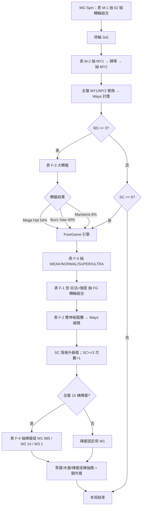

# 吉屋出豬 機率規格書（Content 軌）

> 3×5 Ways、雙神秘圖騰主遊戲。6 顆 SC 進 FG、3 顆 BS 進大轉盤（大帽子／推土機／豪宅三變體）；FG 中 SC 落格蓋房子（草屋→木屋→磚屋），全盤 15 棟磚屋換大獎池。
> 數值來源：機率表 V12 A版（configB）＋ 2026-10-08 重跑 1,000 萬局快測。「來源」欄標 xlsx 座標 / 快測報告 / 規格書章節。

## 1. 規格簡述

### 基本規格

| 項目 | 值 | 來源 |
|---|---|---|
| 盤面 | 3x5 | 規格簡述!C4 |
| 對獎方式 | All Ways | 規格簡述!C5 |
| 基本收費 | 75 | 規格簡述!C6 |
| 快測 TotalBet | 50 | qt_20261008_1e7_asis.txt |
| 一般圖騰數 | 11 | 規格簡述!C7 |
| 特殊圖騰數 | 6 | 規格簡述!C8（Wild／Scatter／Wheel／房子×3）|

### Pay table（odds × Line bet）

| 層級 | 符號 | x3 | x4 | x5 | 來源 |
|---|---|---|---|---|---|
| High Pay Symbols | M1 | 10 | 30 | 150 | 規格簡述!ODDS |
| High Pay Symbols | M2 | 10 | 25 | 100 | 規格簡述!ODDS |
| High Pay Symbols | M3 | 10 | 20 | 75 | 規格簡述!ODDS |
| High Pay Symbols | M4 | 5 | 15 | 50 | 規格簡述!ODDS |
| High Pay Symbols | M5 | 5 | 10 | 25 | 規格簡述!ODDS |
| Low Pay Symbols | A | 5 | 8 | 15 | 規格簡述!ODDS |
| Low Pay Symbols | K | 5 | 8 | 15 | 規格簡述!ODDS |
| Low Pay Symbols | Q | 5 | 8 | 15 | 規格簡述!ODDS |
| Low Pay Symbols | J | 5 | 8 | 15 | 規格簡述!ODDS |
| Low Pay Symbols | 10 | 2 | 5 | 10 | 規格簡述!ODDS |
| Low Pay Symbols | 9 | 2 | 5 | 10 | 規格簡述!ODDS |

### 機率人員簡述

<!-- human:summary -->
主遊戲以 62 組轉輪組合混搭 12 條帶（K-022），停輪後抽雙神秘圖騰 MY1／MY2 互斥替換（K-016）製造爆分；盤面 SC≥6 進 FG、BS≥3 進大轉盤。大轉盤 V12 拔掉 JP，只分流大帽子 54%／推土機 40%／豪宅 6% 三種 FG 變體（K-NEW-01）。FG 中 SC 落格把框升級（一般→紅→金），結算依框等級變草屋／木屋／磚屋抽獎（K-NEW-02），全盤 15 棟磚屋切大獎池（K-017）。FG 強度 WEAK/NORMAL/SUPER/ULTRA 23:60:16:1 只改每手保證 SC 顆數的轉輪組合權重（K-024），不動獎項表。快測 1,000 萬局總 RTP 99.98%。
<!-- /human -->

## 2. 數據資料

### 快測摘要

> 以 2026-10-08 重跑 1,000 萬局（configB）為準；Excel 內嵌截圖為 JP 拔掉前，已過時。

| 指標 | 值 | 來源 |
|---|---|---|
| 總 RTP | 99.98% | qt_20261008_1e7_asis.txt |
| 主遊戲 RTP | 43.26% | qt_20261008_1e7_asis.txt |
| 免費遊戲 RTP | 18.95% | qt_20261008_1e7_asis.txt |
| 主遊戲命中率 | 30.43% | qt_20261008_1e7_asis.txt |
| 主遊戲最大倍數 | 2788.5 | qt_20261008_1e7_asis.txt |
| FG 觸發率 | 0.341% | qt_20261008_1e7_asis.txt |
| FG 平均觸發局數 | 293.2 | qt_20261008_1e7_asis.txt |
| FG 平均倍率 | 55.58 | qt_20261008_1e7_asis.txt |
| FG 最大倍數 | 2518.5 | qt_20261008_1e7_asis.txt |
| 總手數 | 10000000 | qt_20261008_1e7_asis.txt |
| golden RTP | 94.79% | 參數表!N18（過時，見 §9-3）|
| 目標 RTP | 100 | 推論（§2 補償算式）|
| 容許誤差 | 0.88 pp | 95% CI 半寬 |

### 快測基本資訊（BASE INFO）

| 階段 | RTP | Freq（每幾手） | Trigger % | 平均倍率 | PlayTimes | RetriRate | 最大倍率 |
|---|---|---|---|---|---|---|---|
| 主遊戲 | 43.26% | — | 30.43% | — | 10000000 | 70.18% | 2788.5 |
| 免費遊戲 | 18.95% | 293.2 | 0.341% | 55.58 | 34107 | — | 2518.5 |
| 大轉盤 | 37.76% | 340.0 | 0.294% | 128.40 | 29411 | — | 2788.5 |
| 總計 | 99.98% | 157.4 | — | — | 10000000 | — | 2788.5 |

### 大轉盤三變體實測

| 變體 | 次數 | 週期 | 均倍 | RTP | 平均手數 | 來源 |
|---|---|---|---|---|---|---|
| Mega Hat 大帽子 | 15814 | 632.4 | 101.03 | 15.98% | 8.67 | qt_20261008_1e7_asis.txt |
| Buzz Saw 推土機 | 11866 | 842.7 | 142.41 | 16.90% | 9.41 | qt_20261008_1e7_asis.txt |
| Mansions 豪宅 | 1731 | 5777.0 | 282.36 | 4.89% | 6.72 | qt_20261008_1e7_asis.txt |
| Free（SC 觸發） | 34107 | 293.2 | 55.58 | 18.95% | 7.68 | qt_20261008_1e7_asis.txt |

### FG 強中弱實測分佈

| 組別 | F-1 權重 | 理論佔比 | 次數 | 實際佔比 | FG RTP 貢獻 |
|---|---|---|---|---|---|
| ULTRA | 1 | 1% | — | — | — |
| SUPER | 16 | 16% | — | — | — |
| NORMAL | 60 | 60% | — | — | — |
| WEAK | 23 | 23% | — | — | — |

### FG 強度 × 玩法均倍

| 玩法 | WEAK | NORMAL | SUPER | ULTRA | 來源 |
|---|---|---|---|---|---|
| Free | 42.50 | 55.42 | 71.11 | 119.74 | qt_20261008_1e7_asis.txt |
| Mega Hat | 73.97 | 96.69 | 149.84 | 227.20 | qt_20261008_1e7_asis.txt |
| Buzz Saw | 113.25 | 137.27 | 194.16 | 280.74 | qt_20261008_1e7_asis.txt |
| Mansions | 235.00 | 275.03 | 360.54 | 611.43 | qt_20261008_1e7_asis.txt |
| 四玩法合計 | 69.47 | 86.58 | 121.93 | 193.89 | qt_20261008_1e7_asis.txt |

## 3. 機率流程圖



### 流程補充

<!-- human:flow-notes -->
機率表「機率流程圖」分頁為空，上圖依程式與 GAME_FLOW_ARCHITECTURE.md 轉寫〔推論〕。關鍵節點：MG 抽輪帶組（表 M-1）→ 神秘圖騰替換（表 M-2）→ Feature 分流（SC 走 FG、BS 走大轉盤 表 F-3）→ FG 引擎（強度 表 F-0、組合 表 F-1、圖騰 表 F-2）→ 房子結算（表 F-4）。大轉盤三種結果都進同一個 FG 引擎，只換參數組。
<!-- /human -->

## 4. 參數表

### 表 M-1　主遊戲輪帶組分類與權重〔K-022〕

| Index | 組合 | 權重 | 說明 | TOTAL RTP | FG RTP | 來源 |
|---|---|---|---|---|---|---|
| 0 | 5 5 8 8 3 | 11000 | 均勻 | 5.03 | 5.03 | 參數表!C18 |
| 1,2 | 0 0 0 6 1 / 0 0 0 2 0 | 26500 | 大圖騰 3~4 連線 | 96.78 | 101.16 | 參數表!C18 |
| 3 | 0 3 0 6 5 | 125000 | 大圖騰 3 連線（含 BS 帶） | 33.33 | 0 | 參數表!C18 |
| 4-6 | 9 3 8 0 0 等 | 24000 | 不連線 | 0 | 0 | 參數表!C18 |
| 7 | 6 8 2 2 6 | 11000 | 大圖騰 4 連線 | 102.58 | 0 | 參數表!C18 |
| 8 | 2 2 2 2 9 | 2500 | 大圖騰 4 連線 | 894.13 | 0 | 參數表!C18 |
| 9 | 0 7 7 0 7 | 500 | 大圖騰 5 連線 | 1968.78 | 0 | 參數表!C18 |
| 10-29 | 三輪 BS 帶 | 548 | BONUS 組（進大轉盤） | 1031.70 | 0 | 參數表!C18 |
| 30-49 | 三輪 SC 帶 | 86 | 0-9sc（FG 觸發組） | 3263.30 | 3263.30 | 參數表!C18 |
| 50-58 | 10 0 0 0 8 等 | 2000 | 多 SC 不連線（近失） | 0 | 0 | 參數表!C18 |
| 59-61 | 11 2 11 2 2 等 | 500 | BS 聽牌（近失） | 0 | 0 | 參數表!C18 |

### 表 M-2　主遊戲神秘圖騰〔K-016〕

| 符號 | MY1 | MY2 | 來源 |
|---|---|---|---|
| M1 | 35 | 10 | 參數表!C87 |
| M2 | 45 | 10 | 參數表!C87 |
| M3 | 55 | 10 | 參數表!C87 |

### 表 F-0　FG 強度組別〔K-024〕

| 組別 | 權重 | 備註 | 來源 |
|---|---|---|---|
| ULTRA | 1 | 四玩法共用 | 參數表!C103 |
| SUPER | 16 | 四玩法共用 | 參數表!C103 |
| NORMAL | 60 | 四玩法共用 | 參數表!C103 |
| WEAK | 23 | 四玩法共用 | 參數表!C103 |

### 表 F-1　FG 每手 SC 顆數分布〔K-NEW-04〕

| 玩法 | WEAK | NORMAL | SUPER | ULTRA | 來源 |
|---|---|---|---|---|---|
| Free 每手 SC 期望 | 1.16 | 1.31 | 1.46 | 1.82 | 參數表!AB113 |
| Mega Hat 每手 SC 期望 | 1.41 | 1.63 | 1.88 | 2.14 | 參數表!AB113 |
| Buzz Saw 每手 SC 期望 | 1.51 | 1.66 | 1.90 | 2.24 | 參數表!AB113 |
| Mansions 每手 SC 期望 | 0.96 | 1.44 | 1.90 | 2.41 | 參數表!AB113 |

### 表 F-2　FG 神秘圖騰〔K-016〕

| 符號 | MY1 | MY2 | 來源 |
|---|---|---|---|
| H1 | 10 | 8 | 參數表!C166 |
| H2 | 15 | 9 | 參數表!C166 |
| H3 | 15 | 10 | 參數表!C166 |
| H4 | 70 | 12 | 參數表!C166 |
| H5 | 70 | 12 | 參數表!C166 |

### 表 F-3　大轉盤格權重〔K-NEW-01〕

| 結果 | 權重 | 佔比 | 來源 |
|---|---|---|---|
| Mega Hat 大帽子 | 2700 | 54% | 參數表!C200 |
| Buzz Saw 推土機 | 2000 | 40% | 參數表!C200 |
| Mansions 豪宅 | 300 | 6% | 參數表!C200 |
| JP（已拔掉） | 0 | 0% | 參數表!C200 |

### 表 F-4　房子獎項期望（× TotalBet）〔K-NEW-02 / K-017〕

| 房子 | 期望 | 備註 | 來源 |
|---|---|---|---|
| 草屋 | 0.70 | 0.5(60)/1(40) | 參數表!A217 |
| 木屋 | 3.25 | 2/3/5/MINI/MINOR | 參數表!A217 |
| 磚屋 W1 | 25.52 | 一般；全盤 15 棟時 98.5% | 參數表!A217 |
| 磚屋 W2 | 55.00 | 全盤 15 棟時 1.4% | 參數表!A217 |
| 磚屋 W3 | 100.00 | 全盤 15 棟時 0.1%（§9-5 修正）| 參數表!A217 |

### 觸發與上限參數

| 參數 | 值 | 來源 |
|---|---|---|
| 進 FG 門檻（SC 顆數） | 6 | 規格簡述!SCATTER |
| FG 中追加次數門檻（SC 顆數） | 3 | 規格簡述!SCATTER |
| 進大轉盤門檻（BS 顆數） | 3 | 規格簡述!WHEEL |
| 盤面最大 BS 顆數 | 3 | qt_20261008_1e7_asis.txt |
| 最大贏分倍數（MaxWin） | 2788.5 | qt_20261008_1e7_asis.txt |

### 參數備註

<!-- human:param-notes -->
A 版對應 configB.json（不是 configA）。sync_gap：M-1 BONUS 組權重 機率表 548 / 程式 547，每組 −0.18%，估 Total RTP 約 −0.07pp（§9-2）。表 M-1 的 N 欄 golden RTP 94.79% 已過時（JP 拔掉前值），應以快測 RTP by Reel Combination 回填（§9-3）。
<!-- /human -->

## 5. 競品資料／手法對應

<!-- human:competitor -->
| 機制（參數表） | 說明 | 對應手法卡 | 收錄目的 |
|---|---|---|---|
| 表 M-1 | 62 組轉輪組合混搭 12 條帶 | K-022 | MG 主力與近失分離 |
| 表 M-2 / F-2 | 雙神秘圖騰互斥替換（取後不放回） | K-016 | 製造全盤爆分 |
| 表 F-0 / F-1 | FG 強度分層只改每手 SC 顆數分布 | K-024 / K-NEW-04 | 強中弱體感不改獎項表 |
| 表 F-3 | 大轉盤分流三種 FG 變體 | K-NEW-01 | 一盤多玩法 |
| 表 F-4 | 15 棟磚屋動態切換獎池 | K-017 | 強盤面大獎 |
| 近失帶 | 多 SC 不連線 / BS 聽牌 RTP=0 | K-026 | 每 15 局一次近失 |

> 競品參考 Huff N' More Puff〔推論〕；規格簡述只貼一張競品機台照，房子分數區間（50–125/150–600/750–18750）取自競品說明，非本款參數〔推論〕。
<!-- /human -->

## 6. 隱性規則

<!-- human:hidden-rules -->
| 規則 | 設計目的 | 對應表 / K 卡 | 更改需同步 |
|---|---|---|---|
| MY1 與 MY2 互斥（取後不放回） | 保證兩圖騰不同、放大連線 | 表 M-2 / K-016 | 程式 three_pigs_12X.py:L313-327 |
| FG 強度組別對玩家不可見 | 體感波動但賠付表不變 | 表 F-0 / K-024 | 若公開會破壞體感設計 |
| FG 帶 SC 顆數寫死（0/1/2/3） | 用組合權重直接設計 SC 分布 | 表 F-1 / K-NEW-04 | 改帶須重算每手 SC 期望 |
| 金框溢出優先升紅框→一般框→空格 | 玩家看到的是「隨機」 | 表 F-5 / K-NEW-03 | §9-7 規格文字與程式不符，以程式為準 |
| 全盤 15 棟磚屋才切換磚屋組別 | 稀有大獎事件不可見 | 表 F-4 / K-017 | 約 1/14245 局 |
| 黑箱保證豪宅：強制 mansions+ULTRA+W2 | 可控的保證豪宅事件 | 黑箱 / K-NEW-06 | 快測未實作 |
<!-- /human -->

## 輪帶 Strip（附錄）

> 來源：`quicktest/engine/configB.json` 的 `main_reels`（0-11，12 條主遊戲帶）；符號碼由 configB `icon` 反查（1=H1…16=MY2）。顆數由帶面逐格計數，每軸一行、由上而下。reelsets（表 M-1 的 62 組）各軸指定用哪條帶。

### 主遊戲 組 0

| 組 | 軸 | 長度 | H1 | H2 | H3 | M1 | M2 | L1 | L2 | L3 | L4 | L5 | L6 | WILD | SC | BS | MY1 | MY2 |
|---|---|---|---|---|---|---|---|---|---|---|---|---|---|---|---|---|---|---|
| 主遊戲 組 0 | R1 | 50 | 3 | 3 | 4 | 8 | 8 | 0 | 0 | 0 | 0 | 0 | 0 | 0 | 0 | 0 | 24 | 0 |
| 主遊戲 組 0 | R2 | 50 | 3 | 3 | 4 | 8 | 8 | 0 | 0 | 0 | 0 | 0 | 0 | 4 | 0 | 0 | 20 | 0 |
| 主遊戲 組 0 | R3 | 50 | 3 | 3 | 4 | 8 | 8 | 0 | 0 | 0 | 0 | 0 | 0 | 4 | 0 | 0 | 20 | 0 |
| 主遊戲 組 0 | R4 | 50 | 3 | 3 | 4 | 8 | 8 | 0 | 0 | 0 | 0 | 0 | 0 | 4 | 0 | 0 | 20 | 0 |
| 主遊戲 組 0 | R5 | 50 | 3 | 3 | 4 | 10 | 10 | 0 | 0 | 0 | 0 | 0 | 0 | 0 | 0 | 0 | 20 | 0 |

```strip
# 主遊戲 組 0
R1: MY1 MY1 MY1 MY1 M1 M1 MY1 MY1 MY1 MY1 M2 M2 M1 M2 MY1 MY1 MY1 MY1 M1 M1 MY1 MY1 MY1 MY1 M1 M2 MY1 MY1 MY1 MY1 H3 H3 M2 M2 H3 H3 M1 M1 H1 H1 H1 M2 H2 H2 H2 MY1 MY1 MY1 MY1 M2
R2: M1 M1 M2 M2 MY1 MY1 MY1 MY1 M1 H3 MY1 MY1 MY1 MY1 H3 M1 M2 M2 M1 H3 M2 M2 M1 WILD MY1 MY1 MY1 MY1 M2 M2 MY1 MY1 MY1 MY1 M1 M1 H3 WILD MY1 MY1 MY1 MY1 H1 H1 H1 WILD H2 H2 H2 WILD
R3: H2 H2 H2 WILD M1 M2 M1 M2 MY1 MY1 MY1 MY1 H3 M2 MY1 MY1 MY1 MY1 M1 M1 WILD MY1 MY1 MY1 MY1 M2 M1 M1 MY1 MY1 MY1 MY1 M2 M2 MY1 MY1 MY1 MY1 M1 M1 H3 H3 M2 WILD H3 M2 H1 H1 H1 WILD
R4: H1 H1 H1 WILD H2 H2 H2 MY1 MY1 MY1 MY1 M1 MY1 MY1 MY1 MY1 M1 M1 MY1 MY1 MY1 MY1 M2 M2 M1 M2 M2 H3 H3 M1 M2 WILD MY1 MY1 MY1 MY1 M2 M1 MY1 MY1 MY1 MY1 WILD H3 M1 H3 M2 M1 M2 WILD
R5: MY1 H3 M2 M2 H1 H1 H1 M1 H2 H2 H2 M1 M2 M2 M1 M1 MY1 MY1 MY1 MY1 M1 M1 MY1 MY1 MY1 MY1 M2 M2 H3 H3 M1 M1 M2 M2 M1 H3 MY1 MY1 MY1 MY1 M2 M2 MY1 MY1 MY1 MY1 M1 MY1 MY1 MY1
```

### 主遊戲 組 1

| 組 | 軸 | 長度 | H1 | H2 | H3 | M1 | M2 | L1 | L2 | L3 | L4 | L5 | L6 | WILD | SC | BS | MY1 | MY2 |
|---|---|---|---|---|---|---|---|---|---|---|---|---|---|---|---|---|---|---|
| 主遊戲 組 1 | R1 | 47 | 0 | 9 | 10 | 6 | 6 | 4 | 4 | 4 | 4 | 0 | 0 | 0 | 0 | 0 | 0 | 0 |
| 主遊戲 組 1 | R2 | 24 | 1 | 1 | 1 | 1 | 1 | 2 | 1 | 1 | 2 | 3 | 2 | 8 | 0 | 0 | 0 | 0 |
| 主遊戲 組 1 | R3 | 24 | 1 | 1 | 1 | 1 | 1 | 2 | 1 | 1 | 2 | 3 | 2 | 8 | 0 | 0 | 0 | 0 |
| 主遊戲 組 1 | R4 | 24 | 1 | 1 | 1 | 1 | 1 | 2 | 1 | 1 | 2 | 3 | 2 | 8 | 0 | 0 | 0 | 0 |
| 主遊戲 組 1 | R5 | 40 | 0 | 0 | 0 | 7 | 7 | 6 | 4 | 4 | 4 | 4 | 4 | 0 | 0 | 0 | 0 | 0 |

```strip
# 主遊戲 組 1
R1: H2 H2 H2 H2 H2 H3 H3 H3 H3 H3 H3 M1 M1 M2 M2 L1 L2 H2 H2 L3 L4 H3 H3 L1 L4 M1 M1 L2 L3 M2 M2 L1 L3 H2 H2 L2 L4 H3 H3 L2 L1 M1 M1 L4 L3 M2 M2
R2: WILD H1 L5 WILD H2 L6 WILD H3 M1 WILD M2 L1 WILD L2 L3 WILD L6 L4 WILD L1 L5 WILD L5 L4
R3: WILD H1 L5 WILD H2 L6 WILD H3 M1 WILD M2 L1 WILD L2 L3 WILD L6 L4 WILD L1 L5 WILD L5 L4
R4: WILD H1 L5 WILD H2 L6 WILD H3 M1 WILD M2 L1 WILD L2 L3 WILD L6 L4 WILD L1 L5 WILD L5 L4
R5: M1 L1 L2 M2 L3 L4 M1 M2 L5 L6 M1 L1 L6 M2 L3 L2 M1 L5 L4 M2 L2 L5 M1 L1 L4 M2 L6 L3 M1 L3 L2 M2 L4 L1 M2 L6 L1 M1 L5 L1
```

### 主遊戲 組 2

| 組 | 軸 | 長度 | H1 | H2 | H3 | M1 | M2 | L1 | L2 | L3 | L4 | L5 | L6 | WILD | SC | BS | MY1 | MY2 |
|---|---|---|---|---|---|---|---|---|---|---|---|---|---|---|---|---|---|---|
| 主遊戲 組 2 | R1 | 15 | 0 | 0 | 0 | 0 | 0 | 1 | 1 | 2 | 0 | 0 | 1 | 0 | 0 | 0 | 0 | 10 |
| 主遊戲 組 2 | R2 | 15 | 0 | 0 | 0 | 0 | 0 | 2 | 2 | 0 | 1 | 0 | 0 | 0 | 0 | 0 | 0 | 10 |
| 主遊戲 組 2 | R3 | 15 | 0 | 0 | 0 | 0 | 0 | 1 | 0 | 2 | 1 | 0 | 0 | 0 | 0 | 0 | 0 | 11 |
| 主遊戲 組 2 | R4 | 15 | 0 | 0 | 0 | 0 | 0 | 0 | 1 | 1 | 0 | 2 | 1 | 0 | 0 | 0 | 0 | 10 |
| 主遊戲 組 2 | R5 | 15 | 0 | 0 | 0 | 0 | 0 | 0 | 0 | 1 | 2 | 2 | 0 | 0 | 0 | 0 | 0 | 10 |

```strip
# 主遊戲 組 2
R1: MY2 MY2 MY2 MY2 L1 L3 MY2 MY2 L6 MY2 MY2 L2 L3 MY2 MY2
R2: MY2 MY2 MY2 MY2 L2 L2 MY2 MY2 L1 MY2 MY2 L1 L4 MY2 MY2
R3: MY2 MY2 MY2 MY2 L3 L1 MY2 MY2 L3 MY2 MY2 L4 MY2 MY2 MY2
R4: MY2 MY2 MY2 MY2 L6 L5 MY2 MY2 L2 MY2 MY2 L5 L3 MY2 MY2
R5: MY2 MY2 MY2 MY2 L4 L4 MY2 MY2 L5 MY2 MY2 L3 L5 MY2 MY2
```

### 主遊戲 組 3

| 組 | 軸 | 長度 | H1 | H2 | H3 | M1 | M2 | L1 | L2 | L3 | L4 | L5 | L6 | WILD | SC | BS | MY1 | MY2 |
|---|---|---|---|---|---|---|---|---|---|---|---|---|---|---|---|---|---|---|
| 主遊戲 組 3 | R1 | 105 | 6 | 8 | 9 | 14 | 13 | 5 | 6 | 8 | 8 | 7 | 6 | 0 | 0 | 15 | 0 | 0 |
| 主遊戲 組 3 | R2 | 105 | 4 | 7 | 9 | 13 | 13 | 4 | 5 | 8 | 7 | 6 | 5 | 9 | 0 | 15 | 0 | 0 |
| 主遊戲 組 3 | R3 | 105 | 4 | 7 | 9 | 13 | 13 | 4 | 5 | 8 | 7 | 6 | 5 | 9 | 0 | 15 | 0 | 0 |
| 主遊戲 組 3 | R4 | 105 | 2 | 6 | 9 | 15 | 15 | 5 | 5 | 8 | 9 | 6 | 6 | 4 | 0 | 15 | 0 | 0 |
| 主遊戲 組 3 | R5 | 105 | 0 | 6 | 11 | 16 | 17 | 5 | 6 | 8 | 9 | 7 | 5 | 0 | 0 | 15 | 0 | 0 |

```strip
# 主遊戲 組 3
R1: M2 M2 BS L2 H2 H3 L4 L3 M1 M1 BS L6 M2 M2 L6 L5 M1 M1 BS L3 M2 L5 L2 M1 BS L4 M2 L3 BS M2 L6 M1 L4 L3 H2 H2 BS L2 H3 H3 BS L2 H2 M2 M2 BS L5 M1 L2 L1 H1 H1 L1 BS H2 H2 L1 L6 H1 H3 H3 BS L5 M2 L5 L4 M1 M1 BS L4 M1 L3 H3 BS L6 M1 L1 M2 L2 H2 H2 L1 H3 H3 L5 BS M2 L5 M1 H1 H1 M2 L3 L4 M1 BS L6 H1 BS L4 M1 L3 H3 L3 L4
R2: M2 M2 BS L2 H2 H3 WILD L3 M1 M1 BS L6 M2 M2 WILD L5 M1 M1 BS L3 M2 WILD L2 M1 BS L4 M2 L3 BS M2 L6 WILD L4 L3 H2 H2 BS L2 H3 H3 BS L2 WILD M2 M2 BS L5 M1 WILD L1 H1 H1 L1 BS H2 H2 WILD L6 H1 H3 H3 BS L5 M2 L5 WILD M1 M1 BS L4 M1 L3 H3 BS L6 M1 L1 M2 L2 H2 H2 L1 H3 H3 L5 BS M2 L5 M1 WILD L4 M2 L3 L4 M1 BS L6 H1 BS L4 M1 L3 H3 L3 L4
R3: M2 M2 BS L2 H2 H3 WILD L3 M1 M1 BS L6 M2 M2 WILD L5 M1 M1 BS L3 M2 WILD L2 M1 BS L4 M2 L3 BS M2 L6 WILD L4 L3 H2 H2 BS L2 H3 H3 BS L2 WILD M2 M2 BS L5 M1 WILD L1 H1 H1 L1 BS H2 H2 WILD L6 H1 H3 H3 BS L5 M2 L5 WILD M1 M1 BS L4 M1 L3 H3 BS L6 M1 L1 M2 L2 H2 H2 L1 H3 H3 L5 BS M2 L5 M1 WILD L4 M2 L3 L4 M1 BS L6 H1 BS L4 M1 L3 H3 L3 L4
R4: M2 M2 BS L2 H2 H3 L4 L3 M1 M1 BS L6 M2 M2 L6 L5 M1 M1 BS L3 M2 WILD L2 M1 BS L4 M2 L3 BS M2 L6 WILD L4 L3 H2 H2 BS L2 H3 H3 BS L2 M2 M2 M2 BS L5 M1 WILD L1 H1 H1 L1 BS M2 H2 L1 L6 M1 H3 H3 BS L5 M2 L5 L4 M1 M1 BS L4 M1 L3 H3 BS L6 M1 L1 M2 L2 H2 H2 L1 H3 H3 L5 BS M2 L5 M1 WILD L4 M2 L3 L4 M1 BS L6 M1 BS L4 M1 L3 H3 L3 L4
R5: M2 M2 BS L2 H2 H3 L4 L3 M1 M1 BS L6 M2 M2 L6 L5 M1 M1 BS L3 M2 L5 L2 M1 BS L4 M2 L3 BS M2 M2 M2 L4 L3 H2 H2 BS L2 H3 H3 BS L2 H3 H3 M2 BS L5 M1 L2 L1 M2 M2 L1 BS M2 H2 L1 L6 M1 H3 H3 BS L5 M2 L5 L4 M1 M1 BS L4 M1 L3 H3 BS L6 M1 L1 M2 L2 H2 H2 L1 H3 H3 L5 BS M2 L5 M1 M1 L4 M2 L3 L4 M1 BS L6 M1 BS L4 M1 L3 H3 L3 L4
```

### 主遊戲 組 4

| 組 | 軸 | 長度 | H1 | H2 | H3 | M1 | M2 | L1 | L2 | L3 | L4 | L5 | L6 | WILD | SC | BS | MY1 | MY2 |
|---|---|---|---|---|---|---|---|---|---|---|---|---|---|---|---|---|---|---|
| 主遊戲 組 4 | R1 | 40 | 1 | 2 | 2 | 2 | 1 | 1 | 2 | 2 | 1 | 0 | 0 | 0 | 26 | 0 | 0 | 0 |
| 主遊戲 組 4 | R2 | 40 | 1 | 2 | 2 | 2 | 1 | 1 | 2 | 2 | 1 | 0 | 0 | 0 | 26 | 0 | 0 | 0 |
| 主遊戲 組 4 | R3 | 40 | 1 | 2 | 2 | 2 | 1 | 1 | 2 | 2 | 1 | 0 | 0 | 0 | 26 | 0 | 0 | 0 |
| 主遊戲 組 4 | R4 | 40 | 1 | 2 | 2 | 2 | 1 | 1 | 2 | 2 | 1 | 0 | 0 | 0 | 26 | 0 | 0 | 0 |
| 主遊戲 組 4 | R5 | 40 | 1 | 2 | 2 | 2 | 1 | 1 | 2 | 2 | 1 | 0 | 0 | 0 | 26 | 0 | 0 | 0 |

```strip
# 主遊戲 組 4
R1: SC SC SC M1 M1 SC SC SC L4 L3 SC SC SC SC SC SC SC SC H3 H3 SC SC SC H2 H2 SC SC SC L1 M2 SC SC SC L2 L3 SC SC SC L2 H1
R2: SC SC SC M1 M1 SC SC SC L4 L3 SC SC SC SC SC SC SC SC H3 H3 SC SC SC H2 H2 SC SC SC L1 M2 SC SC SC L2 L3 SC SC SC L2 H1
R3: SC SC SC M1 M1 SC SC SC L4 L3 SC SC SC SC SC SC SC SC H3 H3 SC SC SC H2 H2 SC SC SC L1 M2 SC SC SC L2 L3 SC SC SC L2 H1
R4: SC SC SC M1 M1 SC SC SC L4 L3 SC SC SC SC SC SC SC SC H3 H3 SC SC SC H2 H2 SC SC SC L1 M2 SC SC SC L2 L3 SC SC SC L2 H1
R5: SC SC SC M1 M1 SC SC SC L4 L3 SC SC SC SC SC SC SC SC H3 H3 SC SC SC H2 H2 SC SC SC L1 M2 SC SC SC L2 L3 SC SC SC L2 H1
```

### 主遊戲 組 5

| 組 | 軸 | 長度 | H1 | H2 | H3 | M1 | M2 | L1 | L2 | L3 | L4 | L5 | L6 | WILD | SC | BS | MY1 | MY2 |
|---|---|---|---|---|---|---|---|---|---|---|---|---|---|---|---|---|---|---|
| 主遊戲 組 5 | R1 | 63 | 5 | 6 | 4 | 3 | 5 | 7 | 6 | 7 | 7 | 7 | 6 | 0 | 0 | 0 | 0 | 0 |
| 主遊戲 組 5 | R2 | 63 | 5 | 5 | 2 | 3 | 5 | 6 | 5 | 5 | 7 | 7 | 6 | 7 | 0 | 0 | 0 | 0 |
| 主遊戲 組 5 | R3 | 63 | 5 | 5 | 2 | 3 | 5 | 6 | 5 | 5 | 7 | 7 | 6 | 7 | 0 | 0 | 0 | 0 |
| 主遊戲 組 5 | R4 | 63 | 5 | 5 | 2 | 3 | 5 | 6 | 5 | 5 | 7 | 7 | 6 | 7 | 0 | 0 | 0 | 0 |
| 主遊戲 組 5 | R5 | 63 | 5 | 6 | 4 | 3 | 5 | 7 | 6 | 7 | 7 | 7 | 6 | 0 | 0 | 0 | 0 | 0 |

```strip
# 主遊戲 組 5
R1: L4 L3 H3 L5 L1 H3 L6 L5 M2 L3 L1 M1 L5 L4 M2 L2 L2 M1 L6 L4 M1 L2 L6 H2 L6 L4 H2 L3 L4 H2 L5 L4 H3 L3 L2 H3 L6 L5 H1 L1 L4 H1 L3 L3 H1 L6 L2 M2 L1 L1 M2 M2 L3 H1 H1 H2 L5 L1 H2 L1 L5 H2 L2
R2: L4 L3 H3 L5 L1 WILD L6 L5 M2 L3 L1 M1 L5 L4 M2 L2 L2 M1 L6 L4 M1 L2 L6 H2 L6 L4 H2 L3 L4 H2 L5 L4 WILD L3 L2 H3 L6 L5 H1 WILD L4 H1 WILD L3 H1 L6 WILD M2 L1 L1 M2 M2 WILD H1 H1 H2 L5 L1 WILD L1 L5 H2 L2
R3: L4 L3 H3 L5 L1 WILD L6 L5 M2 L3 L1 M1 L5 L4 M2 L2 L2 M1 L6 L4 M1 L2 L6 H2 L6 L4 H2 L3 L4 H2 L5 L4 WILD L3 L2 H3 L6 L5 H1 WILD L4 H1 WILD L3 H1 L6 WILD M2 L1 L1 M2 M2 WILD H1 H1 H2 L5 L1 WILD L1 L5 H2 L2
R4: L4 L3 H3 L5 L1 WILD L6 L5 M2 L3 L1 M1 L5 L4 M2 L2 L2 M1 L6 L4 M1 L2 L6 H2 L6 L4 H2 L3 L4 H2 L5 L4 WILD L3 L2 H3 L6 L5 H1 WILD L4 H1 WILD L3 H1 L6 WILD M2 L1 L1 M2 M2 WILD H1 H1 H2 L5 L1 WILD L1 L5 H2 L2
R5: L4 L3 H3 L5 L1 H3 L6 L5 M2 L3 L1 M1 L5 L4 M2 L2 L2 M1 L6 L4 M1 L2 L6 H2 L6 L4 H2 L3 L4 H2 L5 L4 H3 L3 L2 H3 L6 L5 H1 L1 L4 H1 L3 L3 H1 L6 L2 M2 L1 L1 M2 M2 L3 H1 H1 H2 L5 L1 H2 L1 L5 H2 L2
```

### 主遊戲 組 6

| 組 | 軸 | 長度 | H1 | H2 | H3 | M1 | M2 | L1 | L2 | L3 | L4 | L5 | L6 | WILD | SC | BS | MY1 | MY2 |
|---|---|---|---|---|---|---|---|---|---|---|---|---|---|---|---|---|---|---|
| 主遊戲 組 6 | R1 | 39 | 0 | 0 | 0 | 0 | 0 | 6 | 5 | 3 | 4 | 5 | 3 | 0 | 0 | 0 | 0 | 13 |
| 主遊戲 組 6 | R2 | 39 | 0 | 0 | 0 | 0 | 0 | 8 | 3 | 3 | 4 | 5 | 3 | 0 | 0 | 0 | 0 | 13 |
| 主遊戲 組 6 | R3 | 39 | 0 | 0 | 0 | 0 | 0 | 6 | 3 | 5 | 4 | 5 | 3 | 0 | 0 | 0 | 0 | 13 |
| 主遊戲 組 6 | R4 | 39 | 0 | 0 | 0 | 0 | 0 | 6 | 3 | 3 | 6 | 5 | 3 | 0 | 0 | 0 | 0 | 13 |
| 主遊戲 組 6 | R5 | 39 | 0 | 0 | 0 | 0 | 0 | 6 | 3 | 3 | 4 | 7 | 3 | 0 | 0 | 0 | 0 | 13 |

```strip
# 主遊戲 組 6
R1: L1 L2 MY2 L4 L5 MY2 L1 L1 MY2 L6 L2 MY2 L5 L5 MY2 L3 L4 MY2 L1 L3 MY2 L6 L4 MY2 L1 L1 MY2 L4 L2 MY2 L5 L5 MY2 L3 L6 MY2 L2 L2 MY2
R2: L1 L2 MY2 L4 L5 MY2 L1 L1 MY2 L6 L2 MY2 L5 L5 MY2 L3 L4 MY2 L1 L3 MY2 L6 L4 MY2 L1 L1 MY2 L4 L2 MY2 L5 L5 MY2 L3 L6 MY2 L1 L1 MY2
R3: L1 L2 MY2 L4 L5 MY2 L1 L1 MY2 L6 L2 MY2 L5 L5 MY2 L3 L4 MY2 L1 L3 MY2 L6 L4 MY2 L1 L1 MY2 L4 L2 MY2 L5 L5 MY2 L3 L6 MY2 L3 L3 MY2
R4: L1 L2 MY2 L4 L5 MY2 L1 L1 MY2 L6 L2 MY2 L5 L5 MY2 L3 L4 MY2 L1 L3 MY2 L6 L4 MY2 L1 L1 MY2 L4 L2 MY2 L5 L5 MY2 L3 L6 MY2 L4 L4 MY2
R5: L1 L2 MY2 L4 L5 MY2 L1 L1 MY2 L6 L2 MY2 L5 L5 MY2 L3 L4 MY2 L1 L3 MY2 L6 L4 MY2 L1 L1 MY2 L4 L2 MY2 L5 L5 MY2 L3 L6 MY2 L5 L5 MY2
```

### 主遊戲 組 7

| 組 | 軸 | 長度 | H1 | H2 | H3 | M1 | M2 | L1 | L2 | L3 | L4 | L5 | L6 | WILD | SC | BS | MY1 | MY2 |
|---|---|---|---|---|---|---|---|---|---|---|---|---|---|---|---|---|---|---|
| 主遊戲 組 7 | R1 | 4 | 0 | 0 | 0 | 0 | 0 | 0 | 0 | 0 | 0 | 0 | 0 | 0 | 0 | 0 | 2 | 2 |
| 主遊戲 組 7 | R2 | 4 | 0 | 0 | 0 | 0 | 0 | 0 | 0 | 0 | 0 | 0 | 0 | 0 | 0 | 0 | 2 | 2 |
| 主遊戲 組 7 | R3 | 4 | 0 | 0 | 0 | 0 | 0 | 0 | 0 | 0 | 0 | 0 | 0 | 0 | 0 | 0 | 2 | 2 |
| 主遊戲 組 7 | R4 | 4 | 0 | 0 | 0 | 0 | 0 | 0 | 0 | 0 | 0 | 0 | 0 | 0 | 0 | 0 | 2 | 2 |
| 主遊戲 組 7 | R5 | 4 | 0 | 0 | 0 | 0 | 0 | 0 | 0 | 0 | 0 | 0 | 0 | 0 | 0 | 0 | 2 | 2 |

```strip
# 主遊戲 組 7
R1: MY1 MY1 MY2 MY2
R2: MY1 MY1 MY2 MY2
R3: MY1 MY1 MY2 MY2
R4: MY1 MY1 MY2 MY2
R5: MY1 MY1 MY2 MY2
```

### 主遊戲 組 8

| 組 | 軸 | 長度 | H1 | H2 | H3 | M1 | M2 | L1 | L2 | L3 | L4 | L5 | L6 | WILD | SC | BS | MY1 | MY2 |
|---|---|---|---|---|---|---|---|---|---|---|---|---|---|---|---|---|---|---|
| 主遊戲 組 8 | R1 | 29 | 0 | 2 | 2 | 2 | 2 | 2 | 2 | 3 | 3 | 0 | 0 | 0 | 11 | 0 | 0 | 0 |
| 主遊戲 組 8 | R2 | 29 | 0 | 2 | 2 | 2 | 2 | 2 | 2 | 3 | 3 | 0 | 0 | 0 | 11 | 0 | 0 | 0 |
| 主遊戲 組 8 | R3 | 29 | 0 | 2 | 2 | 2 | 2 | 2 | 2 | 3 | 3 | 0 | 0 | 0 | 11 | 0 | 0 | 0 |
| 主遊戲 組 8 | R4 | 29 | 0 | 2 | 2 | 2 | 2 | 2 | 2 | 3 | 3 | 0 | 0 | 0 | 11 | 0 | 0 | 0 |
| 主遊戲 組 8 | R5 | 29 | 0 | 2 | 2 | 2 | 2 | 2 | 2 | 3 | 3 | 0 | 0 | 0 | 11 | 0 | 0 | 0 |

```strip
# 主遊戲 組 8
R1: SC SC M1 M1 SC SC L4 L3 SC SC H3 H3 SC SC H2 H2 M2 SC L1 M2 L1 SC L2 L3 L4 SC L2 L3 L4
R2: SC SC M1 M1 SC SC L4 L3 SC SC H3 H3 SC SC H2 H2 M2 SC L1 M2 L1 SC L2 L3 L4 SC L2 L3 L4
R3: SC SC M1 M1 SC SC L4 L3 SC SC H3 H3 SC SC H2 H2 M2 SC L1 M2 L1 SC L2 L3 L4 SC L2 L3 L4
R4: SC SC M1 M1 SC SC L4 L3 SC SC H3 H3 SC SC H2 H2 M2 SC L1 M2 L1 SC L2 L3 L4 SC L2 L3 L4
R5: SC SC M1 M1 SC SC L4 L3 SC SC H3 H3 SC SC H2 H2 M2 SC L1 M2 L1 SC L2 L3 L4 SC L2 L3 L4
```

### 主遊戲 組 9

| 組 | 軸 | 長度 | H1 | H2 | H3 | M1 | M2 | L1 | L2 | L3 | L4 | L5 | L6 | WILD | SC | BS | MY1 | MY2 |
|---|---|---|---|---|---|---|---|---|---|---|---|---|---|---|---|---|---|---|
| 主遊戲 組 9 | R1 | 10 | 4 | 0 | 0 | 0 | 0 | 0 | 0 | 0 | 0 | 3 | 3 | 0 | 0 | 0 | 0 | 0 |
| 主遊戲 組 9 | R2 | 10 | 4 | 0 | 0 | 0 | 0 | 0 | 0 | 0 | 0 | 3 | 3 | 0 | 0 | 0 | 0 | 0 |
| 主遊戲 組 9 | R3 | 10 | 4 | 0 | 0 | 0 | 0 | 0 | 0 | 0 | 0 | 3 | 3 | 0 | 0 | 0 | 0 | 0 |
| 主遊戲 組 9 | R4 | 27 | 0 | 2 | 2 | 2 | 1 | 1 | 2 | 2 | 1 | 0 | 0 | 0 | 14 | 0 | 0 | 0 |
| 主遊戲 組 9 | R5 | 27 | 0 | 0 | 0 | 9 | 8 | 0 | 0 | 0 | 0 | 0 | 0 | 0 | 0 | 0 | 10 | 0 |

```strip
# 主遊戲 組 9
R1: H1 L5 L6 H1 H1 L6 L6 H1 L5 L5
R2: H1 L5 L6 H1 H1 L6 L6 H1 L5 L5
R3: H1 L5 L6 H1 H1 L6 L6 H1 L5 L5
R4: SC SC M1 M1 SC SC L4 L3 SC SC H3 H3 SC SC H2 H2 SC SC L1 M2 SC SC L2 L3 SC SC L2
R5: MY1 MY1 MY1 M1 M2 MY1 M2 M2 MY1 M1 M1 MY1 MY1 M1 M1 M2 M2 M1 M2 MY1 MY1 M2 M1 M1 M2 MY1 M1
```

### 主遊戲 組 10

| 組 | 軸 | 長度 | H1 | H2 | H3 | M1 | M2 | L1 | L2 | L3 | L4 | L5 | L6 | WILD | SC | BS | MY1 | MY2 |
|---|---|---|---|---|---|---|---|---|---|---|---|---|---|---|---|---|---|---|
| 主遊戲 組 10 | R1 | 10 | 0 | 0 | 0 | 0 | 0 | 0 | 0 | 0 | 0 | 0 | 0 | 0 | 10 | 0 | 0 | 0 |
| 主遊戲 組 10 | R2 | 10 | 0 | 0 | 0 | 0 | 0 | 0 | 0 | 0 | 0 | 0 | 0 | 0 | 10 | 0 | 0 | 0 |
| 主遊戲 組 10 | R3 | 10 | 0 | 0 | 0 | 0 | 0 | 0 | 0 | 0 | 0 | 0 | 0 | 0 | 10 | 0 | 0 | 0 |
| 主遊戲 組 10 | R4 | 10 | 0 | 0 | 0 | 0 | 0 | 0 | 0 | 0 | 0 | 0 | 0 | 0 | 10 | 0 | 0 | 0 |
| 主遊戲 組 10 | R5 | 10 | 0 | 0 | 0 | 0 | 0 | 0 | 0 | 0 | 0 | 0 | 0 | 0 | 10 | 0 | 0 | 0 |

```strip
# 主遊戲 組 10
R1: SC SC SC SC SC SC SC SC SC SC
R2: SC SC SC SC SC SC SC SC SC SC
R3: SC SC SC SC SC SC SC SC SC SC
R4: SC SC SC SC SC SC SC SC SC SC
R5: SC SC SC SC SC SC SC SC SC SC
```

### 主遊戲 組 11

| 組 | 軸 | 長度 | H1 | H2 | H3 | M1 | M2 | L1 | L2 | L3 | L4 | L5 | L6 | WILD | SC | BS | MY1 | MY2 |
|---|---|---|---|---|---|---|---|---|---|---|---|---|---|---|---|---|---|---|
| 主遊戲 組 11 | R1 | 18 | 0 | 0 | 0 | 0 | 0 | 0 | 0 | 0 | 0 | 0 | 0 | 0 | 0 | 6 | 12 | 0 |
| 主遊戲 組 11 | R2 | 18 | 0 | 0 | 0 | 0 | 0 | 0 | 0 | 0 | 0 | 0 | 0 | 0 | 0 | 6 | 12 | 0 |
| 主遊戲 組 11 | R3 | 18 | 0 | 0 | 0 | 0 | 0 | 0 | 0 | 0 | 0 | 0 | 0 | 0 | 0 | 6 | 12 | 0 |
| 主遊戲 組 11 | R4 | 18 | 0 | 0 | 0 | 0 | 0 | 0 | 0 | 0 | 0 | 0 | 0 | 0 | 0 | 6 | 12 | 0 |
| 主遊戲 組 11 | R5 | 18 | 0 | 0 | 0 | 0 | 0 | 0 | 0 | 0 | 0 | 0 | 0 | 0 | 0 | 6 | 12 | 0 |

```strip
# 主遊戲 組 11
R1: BS MY1 MY1 BS MY1 MY1 BS MY1 MY1 BS MY1 MY1 BS MY1 MY1 BS MY1 MY1
R2: BS MY1 MY1 BS MY1 MY1 BS MY1 MY1 BS MY1 MY1 BS MY1 MY1 BS MY1 MY1
R3: BS MY1 MY1 BS MY1 MY1 BS MY1 MY1 BS MY1 MY1 BS MY1 MY1 BS MY1 MY1
R4: BS MY1 MY1 BS MY1 MY1 BS MY1 MY1 BS MY1 MY1 BS MY1 MY1 BS MY1 MY1
R5: BS MY1 MY1 BS MY1 MY1 BS MY1 MY1 BS MY1 MY1 BS MY1 MY1 BS MY1 MY1
```

## 邊界聲明

- 本檔為 md 模式手寫 Content 軌；數字取自機率表 V12 A版（configB）與 2026-10-08 1,000 萬局快測，各表「來源」欄標出處。
- RTP／觸發率引用快測結果（qt_20261008_1e7_asis.txt），非本檔定案。
- 已知對帳差異（收費 50/75、權重 548/547、golden RTP 過時等 10 條）詳見 kb/prob.md §9。
