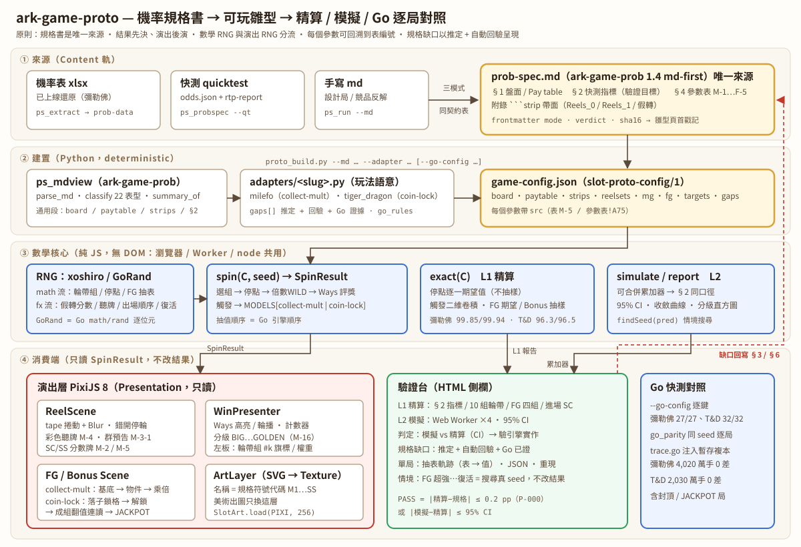

# ark-game-proto 架構



## 四層（單向依賴；唯一回饋邊 = 缺口回寫規格書）

| 層 | 元件 | 職責 | 不做 |
|---|---|---|---|
| ① 來源 | prob-spec.md（ark-game-prob 1.4 md-first）| 唯一事實來源；xlsx / qt / 手寫三模式同一份契約表 | — |
| ② 建置 | `proto_build.py` = `proto_common`（通用段）+ `adapters/<slug>.py`（玩法段）| md → `game-config.json`；每參數帶 `src`；寫 `gaps` / `targets`；`--go-config` 對照與補缺 | 不發明數字 |
| ③ 核心 | `slot-core.js` + `go-rand.js` | RNG 分流、`spin`、`exact`、`simulate/report`、`findSeed`；玩法模型 `MODELS` | 不碰 DOM、不知道動畫 |
| ④ 消費 | PixiJS 演出層、驗證台、`go_parity`（Go 快測引擎）| 只讀 SpinResult | 不改結果 |

## 三條設計原則

1. **結果先決、演出後演**：`spin()` 一次產出完整 SpinResult（盤面、連線、FG / Bonus 全部抽完），演出層只播放。
2. **數學 RNG 與演出 RNG 分流**：`math = rng(seed)`、`fx = rng(seed ^ 0x5bd1e995)`；演出抽選只吃 fx 流 → 模擬與遊玩同 seed 結果一致。
3. **「強制情境」= 搜尋真 seed**：要看 JACKPOT / FG 超強，就往後掃 seed 直到引擎自然轉出，沒有改結果的後門。

## game-config.json（slot-proto-config/1）

```jsonc
{
  "schema": "slot-proto-config/1", "game": "…", "slug": "…", "art": "<adapter>",
  "source": { "md": "prob-spec.md", "sha16": "…", "mode": "xlsx|qt|md", "verdict": "…" },
  "board": { "rows": 3, "reels": 5, "slot_type": "WAYS", "bet": 132, "wild": "WW", "max_win": 10000, "max_win_src": "…" },
  "symbols": ["M1", "…", "WILD", "SC_T"],          // 選配；預設 paytable 鍵 + WW/SC/SS
  "paytable": { "M1": { "3": 20, "4": 60, "5": 250 } },
  "strips": { "sets": [[R1…R5], …] | "set0"/"set1", "fake": [...] },
  "reelsets": [{ "idx": 0, "use"|"flags": [0,1,1,1,1], "w": 40, "src": "表 M-1 …" }],
  "mg": { "wild_mult": { "from": "MY", "to": "WILD", "min": 2, "max": 10 } | "fake_scores"/"tease"（collect-mult 演出）},
  "fg": { "model": "collect-mult|coin-lock", "trigger": { "model": "count|tiger-dragon", … }, "groups": [...], …模型參數 },
  "targets": { "summary": {…§2 快測摘要}, …各模型的 §2 細表 },
  "gaps": [{ "id", "what", "spec", "assume", "check", "auto?", "go?" }],
  "go_check"?: { "rules": [{ "key", "ok": true|false|null, "spec", "go" }], "match", "mismatch", "gap", "filled" },
  "go_parity"?: [{ "seed", "spins", "fg", "capped", "jackpot", "mismatch" }]
}
```

## SpinResult（對齊 2026-09-18 SpinResult / Config 共同契約）

- 金額一律整數 credit；倍數 = credit / bet；`winType` 用 M-16 門檻 1/5/10/25/50/100 倍。
- `spin(C, seed[, {present, rng}])`：同 seed 同結果；`rng: GoRand.create(seed)` 時與 Go 引擎同一條流（跨局沿用）。
- 欄位：`seed, reelset, flags, stops, grid, mult?, mgWin, ways[], trig{cnt,type,mystery?}, fg?, totalWin, capped, winType`；
  `present` 時另有 `symGrid, preGrid?, tags[], tease, fg.seq/revive（collect-mult）, fg.timeline/groups/locked（coin-lock）`。

## 玩法模型

| 模型 | 觸發 | FG / Bonus | 精算方式 |
|---|---|---|---|
| collect-mult | `count`：指定符號顆數 ≥ min | 組別 → 進場分數基底 → 加分物件次數 × 分數 → 乘倍物件 → (基底 + 加分) × (1 + Σ乘倍) | 全解析（觸發 (a,c) 二維卷積 + 各表期望）|
| coin-lock | `tiger-dragon`：混合 ≥5 / 同種 ≥3 / 隨機（rate × 顆數）| 每手逐格擲停入率 → 鎖格 / 重置 / 解鎖列 / JACKPOT → 逐列相鄰 ≥2 成組 → 翻值連讀 → MaxWin 扣在 Bonus | MG 與觸發解析；Bonus 固定 seed 直接抽樣 N 次（附 CI）|

MG All Ways 一律：第一軸須有該符號本身；WILD 替代；有倍數 WILD 時同一 Way 倍數相加（Σ路徑因子 = Πa + Σ M_i Π_{j≠i}(a_j+w_j)，精確且免列舉）。

## 驗證三層

| 層 | 比什麼 | 判定 |
|---|---|---|
| L1 精算 | 引擎精算 vs 規格 §2 | RTP 類 ≤ 容許 pp；平均類相對 1–5% |
| L2 模擬 | Worker 蒙地卡羅 vs 精算（驗引擎實作）| ≤ 95% CI |
| Go 對照 | 設定檔逐鍵（`--go-config`）＋ 同 seed 逐局（`go_parity`）| mismatch = 0 |
| 人眼 | 情境按鈕 + seed 重現 + 抽表軌跡 | 企劃 / 美術 / 編導看節奏 |
